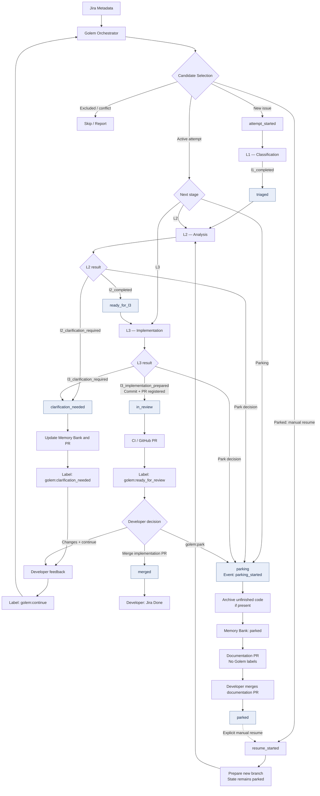
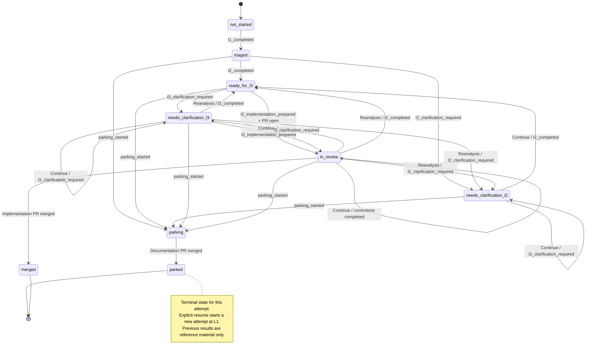

# Project Golem

**AI-assisted Jira Backlog Processing**

**Status:** Draft — do dyskusji zespołowej

## 1. Cel projektu

Project Golem ma doprowadzić do realizacji zadań Jira, które przez wiele miesięcy pozostają w backlogu.

Takie zadania często powstają przy okazji bieżącego developmentu. Opisy bywają skrótowe, bez formalnych acceptance criteria, i zakładają znajomość istniejącego kodu.

Golem ma klasyfikować zadania, analizować ich kontekst, przygotowywać rozwiązania, implementować je oraz współpracować z developerami przez GitHub PR.

**Główną miarą sukcesu jest liczba rzeczywiście zrealizowanych zadań, a nie liczba wygenerowanych analiz lub PR-ów.**

### 1.1. Środowisko

- Java i zespół developerski.
- Claude Code CLI firmy Anthropic.
- GitHub, Pull Requests, code ownership.
- Istniejący CI: build, unit/integration/E2E tests, deployment, static analysis.
- Jira z istniejącym workflow.
- Jira Metadata, Memory Bank oraz indeksy tematyczne.

## 2. Koncepcja rozwiązania

### 2.1. Architektura

| Komponent              | Odpowiedzialność                                      |
|------------------------|-------------------------------------------------------|
| **Golem Orchestrator** | Selekcja, sterowanie, Git, GitHub, zdarzenia i koszty |
| **L1 — Classifier**    | Klasyfikacja tematyczna i powiązane issues            |
| **L2 — Analyst**       | Analiza kodu, wymagań i projektu rozwiązania          |
| **L3 — Implementer**   | Implementacja, testy i poprawki                       |

L1, L2 i L3 są odrębnymi wywołaniami Claude Code, z własnymi promptami i wynikami.

Orchestrator wykonuje operacje deterministyczne bez wywoływania modelu. Może przejść przez kilka etapów podczas jednego uruchomienia.

### 2.2. Główny przepływ



### 2.3. Zasady

- Jira jest dla Golema źródłem danych tylko do odczytu.
- Jira Gateway pozostaje jedynym mechanizmem pobierania danych z Jira API.
- GitHub PR jest interfejsem komunikacji AI z developerem.
- Golem tworzy branche, commity i PR-y.
- **Merge do `develop` wykonuje wyłącznie developer.**
- Developer odpowiada za poprawność i błędy przyjętego kodu.
- Proces Golema jest uruchamiany manualnie.
- Niezakończoną pracę można zaparkować, zachowując dokumentację i ewentualny kod.

## 3. Git workflow i identyfikacja

### 3.1. Konwencje

Podstawowym identyfikatorem zadania jest Jira key.

Wspólny basename:

`PROJECT-1234-implement-anything`

| Artefakt             | Przykład                                         |
|----------------------|--------------------------------------------------|
| Metadata             | `metadata/PROJECT-1234-implement-anything.yml`   |
| Memory Bank          | `memory-bank/PROJECT-1234-implement-anything.md` |
| AI branch            | `ai/PROJECT-1234-implement-anything`             |
| Developer branch     | `PROJECT-1234-implement-anything`        |
| Documentation branch | `docs/PROJECT-1234-implement-anything`           |

Commit messages rozpoczynają się od Jira key, np. `PROJECT-1234 Add validation tests`.

### 3.2. Branch lifecycle

L1, L2 i L3 pracują na tym samym branchu zadania.

Po zaakceptowanym merge developer usuwa branch przez GitHub.

Przy parkowaniu branch AI może zostać usunięty po zabezpieczeniu snapshotu kodu. Wznowienie tworzy nowy branch z aktualnego `develop`.

### 3.3. Release

> [!NOTE]
> Zgodnie z aktualnym flow

Release odbywa się raz w miesiącu:

1. Merge `develop` do `main`.
2. Usunięcie `develop`.
3. Utworzenie nowego `develop` z `main`.

Istniejąca procedura release musi uwzględniać również otwarte PR-y Golema.

## 4. Dane wejściowe i artefakty

### 4.1. Jira Metadata

> [!NOTE]
> Ten fragment infrastruktury już mamy

Istniejący Jira Gateway pobiera:

- Jira key, title, description.
- Labels, epic, attachments.
- Status workflow i pozostałe dostępne metadata.

Golem korzysta z lokalnego snapshotu i nie zapisuje zmian do Jira.

`In Progress` oraz `Done` pozostają pod kontrolą developerów.

### 4.2. Memory Bank

> [!NOTE]
> Ten fragment infrastruktury już mamy

Memory Bank jest wspólnym artefaktem AI i zwykłego developmentu.

Podstawowe sekcje:

- **Context**
- **Solution**
- **Implementation Notes**
- **Decisions**
- **References**

W trakcie pracy mogą występować również AI Findings, Assumptions, Open Questions oraz Parked Reason.

Finalny dokument opisuje rzeczywisty rezultat, bez utrzymywania nieaktualnych pytań.

### 4.3. Labels i indeksy

> [!NOTE]
> Ten fragment infrastruktury (indeksowanie) już mamy

`labels` pochodzą z Jira.

`ai_labels` są przypisywane przez L1 i przechowywane w Memory Banku.

`effective_labels = labels ∪ ai_labels`

Indeksy YAML znajdują się w `metadata/indexes/`. Obejmują `develop` i aktywne branche oraz zachowują dotychczasowy model fuzzy consistency.

Porządkowanie indeksów i taksonomii odbywa się przy release.

## 5. Kontrakt wyników L1/L2/L3

Każde wywołanie AI zwraca jednoznaczny wynik. Orchestrator weryfikuje go przed zapisaniem zdarzenia potwierdzającego zakończenie etapu.

| Etap | Wynik                                | Zdarzenie                    |
|------|--------------------------------------|------------------------------|
| L1   | Klasyfikacja zakończona              | `l1_completed`               |
| L1   | Niepowodzenie                        | `l1_failed`                  |
| L2   | Kontekst gotowy do implementacji     | `l2_completed`               |
| L2   | Potrzebna decyzja developera         | `l2_clarification_required`  |
| L2   | Niepowodzenie                        | `l2_failed`                  |
| L3   | Implementacja przygotowana do review | `l3_implementation_prepared` |
| L3   | Potrzebna decyzja developera         | `l3_clarification_required`  |
| L3   | Niepowodzenie                        | `l3_failed`                  |

Wyniki powodujące niepowodzenie techniczne nie ustanawiają nowego stanu zadania.

`l3_implementation_prepared` oznacza przygotowany kod i testy. Nie oznacza pozytywnego CI, akceptacji review ani merge.

## 6. GitHub PR jako interfejs sterowania

### 6.1. Labels

| Label                        | Ustawia   | Znaczenie                             |
|------------------------------|-----------|---------------------------------------|
| `golem:clarification_needed` | Golem     | Oczekiwanie na informację lub decyzję |
| `golem:ready_for_review`     | Golem     | Wynik przygotowany do review          |
| `golem:continue`             | Developer | Uwzględnij feedback i kontynuuj       |
| `golem:park`                 | Developer | Przygotuj parkowanie                  |

### 6.2. Clarification i review

Golem zapisuje pytania w Memory Banku, aktualizuje PR i ustawia odpowiedni label.

Developer odpowiada przez komentarze, suggestions lub zmiany w branchu.

Następnie ustawia `golem:continue`.

Orchestrator odczytuje nowe informacje i uruchamia właściwy etap L2 albo L3.

GitHub Request changes i zwykłe komentarze są równoważnymi źródłami feedbacku.

### 6.3. Wykonanie poleceń

Polecenia są identyfikowane na podstawie zdarzeń dodania labela w GitHub.

Orchestrator zapisuje identyfikator obsługiwanego zdarzenia, wykonuje polecenie i usuwa label.

Ponowne dodanie labela tworzy nowe polecenie. Ponowienie uruchomienia dla tego samego zdarzenia nie może prowadzić do powtórzenia zakończonej operacji.

## 7. Canonical Task State

### 7.1. Definicja

**`golem_state` jest jedynym kanonicznym stanem zadania.**

Stan jest wyliczany przez orchestrator na podstawie potwierdzonych zdarzeń i aktualnych danych GitHub.

Nie jest ręcznie edytowany.

Memory Bank przechowuje ostatni wynik AI (`ai_status`), natomiast trwały dziennik orkiestratora przechowuje zdarzenia i identyfikatory aktualnej pracy.

### 7.2. Stany

| `golem_state`          | Znaczenie                                  |
|------------------------|--------------------------------------------|
| `not_started`          | Brak rozpoczętej pracy Golema              |
| `triaged`              | L1 zakończone                              |
| `clarification_needed` | Potrzebna decyzja dla L2 lub L3            |
| `ready_for_l3`         | Analiza wystarcza do implementacji         |
| `in_review`            | Przygotowana implementacja i otwarty PR    |
| `parking`              | Trwa procedura parkowania                  |
| `parked`               | Dokumentacja parkowania zmergowana         |
| `merged`               | Implementacyjny PR zmergowany do `develop` |

`merged` odnosi się wyłącznie do implementacji.

Merge dokumentacyjnego PR oznacza `parked`, a nie `merged`.

### 7.3. Przejścia

| Zdarzenie                                 | Stan wynikowy          |
|-------------------------------------------|------------------------|
| `l1_completed`                            | `triaged`              |
| `l2_completed`                            | `ready_for_l3`         |
| `l2_clarification_required`               | `clarification_needed` |
| `l3_implementation_prepared` + otwarty PR | `in_review`            |
| `l3_clarification_required`               | `clarification_needed` |
| Rozpoczęcie parkowania                    | `parking`              |
| Merge dokumentacyjnego PR                 | `parked`               |
| Merge implementacyjnego PR                | `merged`               |

Polecenie `golem:continue` samo w sobie nie zmienia stanu. Zmiana następuje po potwierdzeniu wyniku kolejnego etapu.

### 7.4. Kolejne próby realizacji

Jedno Jira issue może być opracowywane więcej niż raz.

Przykład:

- Próba 1: L1 → L2 → L3 → `parked`.
- Developer merguje dokumentacyjny PR.
- Po kilku miesiącach operator zleca resume.
- Próba 2: nowy branch → L2 → L3 → `merged`.

Techniczny numer `attempt` rozróżnia te próby:

- Pierwsza próba ma `attempt: 1`.
- Każde jawne wznowienie po `parked` otrzymuje następny numer.
- Numer nie jest statusem ani identyfikatorem Jira.
- Zdarzenia, PR-y i snapshoty kodu są przypisane do konkretnej próby.

W ten sposób wcześniejszy merge dokumentacyjnego PR nie przesłania późniejszej pracy.

### 7.5. Diagram



## 8. Trwały kontrakt danych stanu

### 8.1. Podział odpowiedzialności

Dane stanu mają trzy warstwy:

| Warstwa                    | Zawartość                                            | Rola                          |
|----------------------------|------------------------------------------------------|-------------------------------|
| **Memory Bank**            | Wynik AI, kontekst, decyzje, informacje o parkowaniu | Dokumentacja zadania          |
| **Golem Event Journal**    | Zdarzenia, próby, operacje i powiązania z PR         | Trwała historia orkiestratora |
| **GitHub / Jira Metadata** | Rzeczywisty merge, PR lifecycle, status Jira         | Zewnętrzne źródła faktów      |

`golem_state` jest projekcją tych danych, a nie czwartym niezależnym zapisem.

### 8.2. Identyfikacja

Każde zdarzenie zawiera:

| Pole              | Typ              | Znaczenie                            |
|-------------------|------------------|--------------------------------------|
| `schema_version`  | integer          | Wersja kontraktu                     |
| `event_id`        | string           | Unikalny identyfikator zdarzenia     |
| `issue_key`       | string           | Jira key                             |
| `attempt`         | integer          | Numer próby realizacji               |
| `sequence`        | integer          | Kolejność zdarzenia w historii issue |
| `type`            | string           | Typ zdarzenia                        |
| `recorded_at`     | UTC timestamp    | Czas zapisania                       |
| `invocation_id`   | string, optional | Wywołanie Claude Code                |
| `source_event_id` | string, optional | Identyfikator zdarzenia zewnętrznego |
| `refs`            | object, optional | Powiązany branch, SHA, PR lub tag    |

`event_id` zapewnia idempotencję zapisu.

`source_event_id` pozwala rozpoznać ponowne odczytanie tego samego zdarzenia GitHub.

`sequence` jest nadawany atomowo przez orchestrator w zakresie Jira issue. O kolejności jego własnych zdarzeń rozstrzyga `sequence`, nie porównanie timestampów z różnych systemów.

### 8.3. Przykładowe zdarzenie

```yaml
schema_version: 1
event_id: 01JABCDEF0123456789ABCDEFGH
issue_key: PROJECT-1234
attempt: 2
sequence: 37
type: l2_completed
recorded_at: "2026-11-12T00:45:00Z"
invocation_id: l2-20261112-0045

refs:
  branch: ai/PROJECT-1234-implement-anything
  commit: a1b2c3d4e5f678901234567890abcdef12345678
  implementation_pr: 1842
```

Pola `refs` są zależne od rodzaju zdarzenia. Dla ukończonego etapu zapisuje się SHA commitu zawierającego zaakceptowany wynik.

Zdarzenie ukończenia etapu jest rejestrowane dopiero po trwałym zapisaniu jego rezultatu.

### 8.4. Typy zdarzeń

Zdarzenia wpływające na lifecycle:

| `type`                       | Znaczenie                               |
|------------------------------|-----------------------------------------|
| `attempt_started`            | Rozpoczęto pierwszą próbę               |
| `l1_completed`               | Potwierdzono wynik L1                   |
| `l2_completed`               | Potwierdzono gotowość do L3             |
| `l2_clarification_required`  | L2 wymaga decyzji                       |
| `l3_implementation_prepared` | L3 przygotowało implementację i PR      |
| `l3_clarification_required`  | L3 wymaga decyzji                       |
| `parking_started`            | Przyjęto decyzję o parkowaniu           |
| `resume_started`             | Rozpoczęto przygotowanie kolejnej próby |

Zdarzenia techniczne, np. `pr_registered`, `park_archive_created`, `command_accepted`, `command_completed`, `phase_failed` i `conflict_detected`, zapisują postęp i wynik operacji.

**Merge pozostaje faktem GitHub.** Journal może zapisać jego zaobserwowanie, ale nie jest uprawniony do deklarowania merge bez potwierdzenia w GitHub.

### 8.5. Powiązanie PR z zadaniem

Dla każdego PR orchestrator zapisuje:

- `issue_key`.
- `attempt`.
- `kind`: `implementation` albo `documentation`.
- Repozytorium i GitHub PR number.
- Pełny URL.
- Head branch i commit SHA przy rejestracji.
- Base branch.

PR jest identyfikowany przez repozytorium i numer GitHub PR, nie przez samą nazwę brancha.

Rozróżnienie `kind` jest obowiązkowe, ponieważ tylko merge PR `implementation` może ustanowić `merged`.

### 8.6. Kontrakt Memory Banku

Memory Bank zachowuje dotychczasowy frontmatter.

Przykład dla aktywnej pracy:

```yaml
---
jira: PROJECT-1234
labels:
  - api
  - validation
ai_labels:
  - backward_compatibility

ai_status: ready_for_l3
golem_attempt: 2
pull_request: https://github.com/example-org/example-repo/pull/1842
---
```

`golem_attempt` wiąże zapisany wynik z odpowiednią próbą.

Dopuszczalne wartości `ai_status`:

| `ai_status`              | Znaczenie                               |
|--------------------------|-----------------------------------------|
| `triaged`                | Wynik L1                                |
| `ready_for_l3`           | Wynik L2                                |
| `needs_clarification_l2` | Pytania L2                              |
| `needs_clarification_l3` | Pytania L3                              |
| `implemented`            | Wynik L3                                |
| `parked`                 | Dokumentacja przygotowana do parkowania |

`ai_status` jest checkpointem dokumentacyjnym. Nie reprezentuje faktu merge i nie jest edytowany w celu odzwierciedlenia GitHub PR state.

Dla `parked` dopuszczalny jest dodatkowy `parked_code` z tagiem i SHA.

### 8.7. Przechowywanie Event Journal

Journal musi przetrwać:

- Usunięcie AI brancha.
- Zamknięcie PR.
- Parkowanie i wznowienie.
- Odtworzenie `develop`.
- Przerwanie i ponowne uruchomienie orchestratora.

Dlatego nie może być przechowywany wyłącznie na krótkotrwałym branchu roboczym.

Kontrakt logiczny: **append-only journal per Jira issue**, trwale dostępny między uruchomieniami Golema.

Format może być JSONL, z jednym zdarzeniem w rekordzie. Lokalizacja jest konfigurowalna, ale musi zapewniać trwałość, atomowy zapis i blokowanie równoległych modyfikacji tego samego issue.

Zmiana wcześniejszego zdarzenia nie jest normalną operacją. Korekta jest zapisywana jako kolejne zdarzenie.

### 8.8. Ustalanie aktualnej próby

Dla issue bez wcześniejszej pracy używany jest `attempt: 1`.

Po `parked` operator może rozpocząć resume. Orchestrator rezerwuje kolejny numer `attempt` i zapisuje `resume_started`.

**Nowa próba staje się aktualna po potwierdzeniu pierwszego wyniku L1/L2/L3.**

Do tego momentu ostatni potwierdzony stan pozostaje `parked`. Niedokończone resume jest widoczne w historii operacji.

Po aktywacji nowej próby:

- Jej wynik służy do wyznaczania aktualnego stanu.
- Historyczne PR-y wcześniejszych prób pozostają referencjami.
- Wcześniejszy dokumentacyjny merge nie ustanawia `parked` dla nowej próby.
- Archiwalny tag może służyć jako źródło kodu referencyjnego.

Stan `merged` jest końcowy dla issue. Jego ponowna realizacja wymaga nowego zadania Jira.

### 8.9. Reguły wyznaczania `golem_state`

Dla aktualnej próby:

| Warunek                                                  | `golem_state`          |
|----------------------------------------------------------|------------------------|
| Potwierdzony merge implementacyjnego PR                  | `merged`               |
| Potwierdzony merge dokumentacyjnego PR parkowania        | `parked`               |
| `parking_started`, bez zakończenia parkowania            | `parking`              |
| Ostatni zaakceptowany wynik L2/L3 wymaga decyzji         | `clarification_needed` |
| L3 przygotowało implementację i właściwy PR jest otwarty | `in_review`            |
| Ostatni zaakceptowany wynik L2 to `l2_completed`         | `ready_for_l3`         |
| Ostatni zaakceptowany wynik L1 to `l1_completed`         | `triaged`              |
| Brak zaakceptowanego wyniku                              | `not_started`          |

Reguły są oceniane w kolejności określonej powyżej, ale wyłącznie dla zdarzeń i PR-ów przypisanych do właściwej próby.

Jeśli operacja resume została rozpoczęta, lecz nie ustanowiła jeszcze nowej aktualnej próby, zachowany zostaje stan poprzedniej próby.

Nieaktualny indeks lub historyczny label nie może nadpisać potwierdzonego wyniku.

### 8.10. Spójność aktualizacji

Orchestrator używa dwóch etapów technicznych:

1. **Prepare:** zapisuje zamiar operacji wraz z identyfikatorem i oczekiwanym stanem źródeł.
2. **Confirm:** po sprawdzeniu rzeczywistego skutku zapisuje zdarzenie zakończenia.

Przykładowo `l3_implementation_prepared` może zostać zatwierdzone dopiero, kiedy istnieje commit z rezultatem oraz zarejestrowany otwarty PR.

Jeżeli proces zakończy się pomiędzy tymi etapami, kolejne uruchomienie sprawdza rzeczywiste artefakty i kończy rozpoczętą operację.

Dzięki temu ponowienie nie powoduje automatycznie kolejnego kosztownego wywołania Claude Code.

### 8.11. Konkurencyjne uruchomienia

Dla jednego Jira issue może być aktywna najwyżej jedna operacja modyfikująca jego stan.

Orchestrator zakłada blokadę na czas przetwarzania issue i kontroluje oczekiwany Git head SHA przed push.

Przed operacją na PR odświeża jego bieżący stan.

Jeżeli developer w międzyczasie wykonał merge, zamknął PR lub zmodyfikował branch, orchestrator ponownie ocenia operację zamiast wykonywać ją na nieaktualnych danych.

### 8.12. Konflikty

| Sytuacja                                                    | Działanie                                          |
|-------------------------------------------------------------|----------------------------------------------------|
| Nieaktualny informacyjny label                              | Automatyczne uzgodnienie                           |
| Nieaktualny indeks                                          | Korekta przy regeneracji                           |
| `golem:continue` i `golem:park` jednocześnie                | Wstrzymanie poleceń                                |
| Dwa aktywne PR implementacyjne dla tej samej próby          | Wstrzymanie i decyzja developera                   |
| PR zamknięty bez merge, poza procedurą parkowania           | Konflikt lifecycle                                 |
| Jira `Done`, brak merge implementacyjnego PR                | Pominięcie i raport rozbieżności                   |
| Developer przejął issue (`In Progress` albo aktywny branch) | Wstrzymanie modyfikacji AI                         |
| Niedostępny GitHub podczas weryfikacji stanu PR             | Brak operacji zależnych od aktualnego stanu GitHub |
| Uszkodzony lub niezgodny rekord Journal                     | Wstrzymanie issue i diagnostyka                    |

Konflikt jest zdarzeniem diagnostycznym, nie wartością `golem_state`.

Orchestrator zachowuje ostatni potwierdzony stan oraz rejestruje powód blokady.

### 8.13. Wersjonowanie i projekcje

Każdy rekord Journal ma `schema_version`.

Nieznana wersja kontraktu jest błędem walidacji. Migracja danych odbywa się jawnie, bez zgadywania znaczenia pól.

Raporty mogą przechowywać cache wyliczonego `golem_state`, wraz z czasem odświeżenia i referencją do ostatniego przetworzonego zdarzenia.

**Cache nie jest źródłem prawdy dla operacji modyfikujących GitHub.**

## 9. Parkowanie

### 9.1. Cel

Parkowanie zachowuje wynik analizy bez integrowania niedokończonego kodu produkcyjnego.

Golem przygotowuje Memory Bank i zwykły dokumentacyjny PR do `develop`.

### 9.2. Archiwizacja kodu

Jeżeli istnieje częściowa implementacja, Golem zapisuje jej commit i tworzy trwały Git tag.

Przykład:

`golem/parked/PROJECT-1234-implement-anything/attempt-2`

Tag jest unikalny dla próby, nie jest nadpisywany przy późniejszym parkowaniu.

Przed usunięciem brancha Golem potwierdza publikację taga i zgodność SHA.

### 9.3. Frontmatter

```yaml
---
jira: PROJECT-1234
ai_status: parked
golem_attempt: 2
pull_request: https://github.com/example-org/example-repo/pull/1842

parked_code:
  tag: golem/parked/PROJECT-1234-implement-anything/attempt-2
  commit: a1b2c3d4e5f678901234567890abcdef12345678
---
```

Jeżeli nie powstał kod wymagający archiwizacji, `parked_code` jest pomijane.

### 9.4. Documentation PR

Golem:

1. Tworzy branch `docs/<basename>` z aktualnego `develop`.
2. Przenosi Memory Bank i niezbędne metadata.
3. Otwiera zwykły dokumentacyjny PR.
4. Zamyka oryginalny PR implementacyjny bez merge, po zabezpieczeniu kodu.
5. Rejestruje powiązania PR w Journal.

**Dokumentacyjny PR nie otrzymuje labels Golema.**

Developer wykonuje review i merge w zwykłym trybie.

Dopiero potwierdzony merge tego PR ustanawia `golem_state: parked`.

Jeżeli dokumentacyjny PR zostanie zamknięty bez merge, stan pozostaje `parking`, a orchestrator zgłasza konflikt wymagający rozstrzygnięcia.

### 9.5. Wznowienie

Wznowienie wymaga jawnego polecenia operatora.

Golem odczytuje dokumentację, historię PR i ewentualny tag, przygotowuje branch z aktualnego `develop` oraz rozpoczyna nową próbę.

Wcześniejszy kod jest materiałem referencyjnym, nie automatycznie obowiązującym rozwiązaniem.

## 10. Selekcja issues

Orchestrator wybiera kandydatów na podstawie lokalnych Jira metadata, historii Golema, Memory Banków i GitHub.

| Warunek                              | Zachowanie                               |
|--------------------------------------|------------------------------------------|
| Brak rozpoczętej pracy, Jira backlog | Kandydat do L1                           |
| Jira `In Progress`                   | Pomiń                                    |
| Jira `Done`                          | Pomiń                                    |
| Aktywny branch developera            | Pomiń                                    |
| Aktywna praca Golema                 | Kontynuuj zgodnie z etapem i poleceniami |
| `parking`                            | Obsłuż trwającą procedurę                |
| `parked`                             | Pomiń, chyba że jawne resume             |
| `merged`                             | Pomiń                                    |
| Konflikt danych stanu                | Wstrzymaj issue                          |

Memory Bank z `ai_status: parked` stanowi dodatkowy sygnał, że issue nie powinno być wybierane jako nowy task. Orchestrator uzgadnia go z historią parkowania i aktualną próbą.

## 11. Historia wykonania i koszty

Dla każdego wywołania AI rejestrujemy:

- Jira key i attempt.
- Etap oraz identyfikator wywołania.
- Model.
- Czas rozpoczęcia i zakończenia.
- Tokens i koszt.
- Wynik lub błąd.
- Commit i PR.
- Powiązany event.

Dla operacji orkiestratora rejestrujemy również przyjęcie polecenia, przygotowanie i publikację PR, archiwizację kodu, resume i konflikty.

Historia jest niezależna od Memory Banku i pozwala odtworzyć przebieg po przerwaniu procesu.

## 12. Uruchamianie

Proces Golema jest uruchamiany manualnie.

Operator może:

- Przetworzyć wybrane issues z backlogu.
- Obsłużyć polecenia GitHub PR.
- Kontynuować rozpoczęte zadanie.
- Wznowić parked issue.
- Wygenerować raport.
- Ponownie uzgodnić stan po rozwiązaniu konfliktu.

Developerzy komunikują się z Golemem przede wszystkim przez GitHub PR.

## 13. Release

Obowiązuje miesięczny release z odtworzeniem `develop` z `main`.

Zamknięcie PR w wyniku procedury release nie oznacza `merged` ani `parked`.

Orchestrator zachowuje referencje do PR oraz ostatni potwierdzony wynik pracy. Dalsza obsługa jest zgodna z procedurą release.

## 14. PoC i kryteria oceny

| Faza | Zakres                                       |
|------|----------------------------------------------|
| A    | Orchestrator, selekcja, L1, Journal i koszty |
| B    | L2, GitHub PR, labels i feedback             |
| C    | L3, CI, review i merge                       |
| D    | Parkowanie, archiwizacja oraz wznowienie     |

Raport powinien pokazywać liczbę przeanalizowanych, zaimplementowanych, zmergowanych i zaparkowanych issues, koszt AI oraz nakład pracy developerskiej.

Osobno raportuje błędy techniczne i konflikty stanu.

## 15. Podsumowanie

Project Golem wykorzystuje istniejącą infrastrukturę Jira, GitHub, CI, Memory Bank i indeksy tematyczne.

Stan zadania ma jeden kanoniczny model:

- **`golem_state`** — stan wyliczony.
- **`ai_status`** — ostatni potwierdzony wynik pracy AI w Memory Banku.
- **Event Journal** — trwała historia zdarzeń i prób realizacji.
- **GitHub** — źródło prawdy o PR i merge.
- **Jira Metadata** — status biznesowy issue.

Numer `attempt` pozwala rozróżnić historyczne parkowanie od późniejszej pracy bez wprowadzania kolejnych statusów.

Orchestrator zapewnia idempotencję, trwałość wyników oraz kontrolę konfliktów. Człowiek zachowuje pełną odpowiedzialność za merge i code ownership.

**Miarą sukcesu pozostaje liczba rzeczywiście zrealizowanych, długo zalegających Jira issues.**
