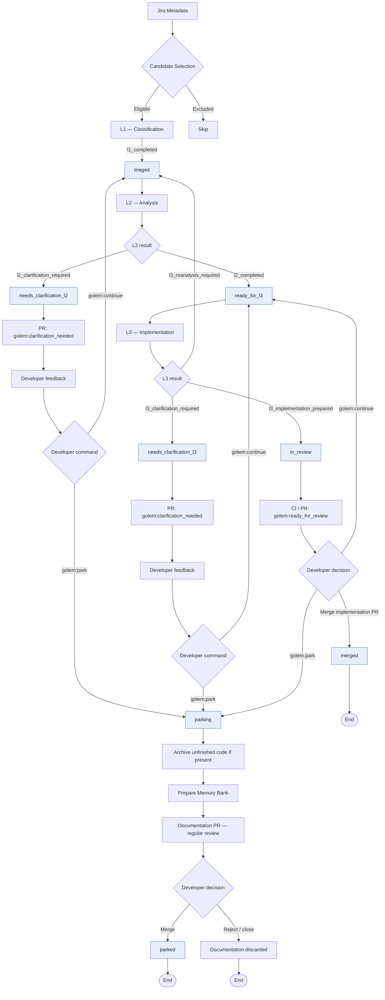

# Project Golem

**AI-assisted Jira Backlog Processing**

**Status:** Draft — do dyskusji zespołowej

## 1. Cel projektu

Project Golem ma pomagać w realizacji zadań Jira, które przez wiele miesięcy pozostają w backlogu.

Zadania te często powstają przy okazji bieżącego developmentu. Ich opisy bywają skrótowe, bez formalnych acceptance criteria, i zakładają znajomość istniejącego systemu.

Golem wykorzystuje AI do klasyfikacji zadań, analizy wymagań, przygotowywania rozwiązań, implementacji oraz współpracy z developerami przez GitHub PR.

**Główną miarą sukcesu jest liczba rzeczywiście zrealizowanych zadań, nie liczba wykonanych analiz ani wygenerowanych PR-ów.**

### 1.1. Środowisko

- Java i zespół developerski.
- Claude Code CLI firmy Anthropic.
- GitHub, Pull Requests, code ownership.
- Istniejący CI: build, unit/integration/E2E tests, deployment, static analysis.
- Jira z istniejącym workflow.
- Istniejąca infrastruktura Jira Metadata, Memory Bank i indeksów tematycznych.

## 2. Architektura i przepływ pracy

### 2.1. Komponenty

| Komponent | Odpowiedzialność |
|---|---|
| **Golem Orchestrator** | Selekcja issues, sterowanie, Git, GitHub, logowanie i koszty |
| **L1 — Classifier** | Klasyfikacja tematyczna i powiązane issues |
| **L2 — Analyst** | Zrozumienie zadania i przygotowanie rozwiązania |
| **L3 — Implementer** | Implementacja, testy i poprawki |

L1, L2 i L3 są osobnymi wywołaniami Claude Code, z własnymi promptami i wynikami.

Orchestrator jest skryptem wykonującym operacje deterministyczne i uruchamiającym właściwe etapy AI. Jeżeli wynik pozwala kontynuować, następny etap może rozpocząć się w tym samym uruchomieniu Golema.

### 2.2. Główny przepływ



Diagram pokazuje przejścia wynikające z pracy AI oraz poleceń developera.

W szczególności:

- `golem:continue` po pytaniu L2 wraca do `triaged`, skąd ponownie wykonywane jest L2.
- `golem:continue` po pytaniu L3 wraca do `ready_for_l3`, skąd ponownie wykonywane jest L3.
- `golem:continue` po code review również kieruje pracę do `ready_for_l3`.
- L3 może wykryć konieczność ponownej analizy rozwiązania i skierować zadanie do L2.
- `golem:park` jest poleceniem developera dostępnym przy otwartym PR wymagającym jego reakcji.

`parked` i `merged` są terminalnymi stanami zakończonej pracy. Odrzucenie dokumentacyjnego PR również kończy dany przebieg, z usunięciem odrzuconych artefaktów.

### 2.3. Code ownership

Golem może tworzyć branche, commity i Pull Requests.

**Merge do `develop` zawsze wykonuje developer.**

Developer odpowiada za poprawność kodu wprowadzonego do projektu, w tym kodu wygenerowanego przez AI.

## 3. Git workflow

### 3.1. Konwencje

Identyfikatorem zadania jest Jira key, np. `PROJECT-1234`.

Wspólny basename:

`PROJECT-1234-implement-anything`

| Artefakt | Nazwa |
|---|---|
| Metadata | `metadata/PROJECT-1234-implement-anything.yml` |
| Memory Bank | `memory-bank/PROJECT-1234-implement-anything.md` |
| Developer branch | `PROJECT-1234-implement-anything` |
| AI branch | `ai/PROJECT-1234-implement-anything` |
| Documentation branch | `docs/PROJECT-1234-implement-anything` |

Commit messages zaczynają się od Jira key, np. `PROJECT-1234 Add validation tests`.

L1, L2 i L3 pracują na jednym branchu AI. Po merge developer usuwa branch standardowym mechanizmem GitHub.

### 3.2. Release

Release odbywa się raz w miesiącu:

1. Merge `develop` do `main`.
2. Usunięcie `develop`.
3. Utworzenie nowego `develop` z `main`.

Istniejąca procedura release musi uwzględniać również otwarte PR-y Golema.

## 4. Istniejące źródła danych

### 4.1. Jira Metadata

Istniejący Jira Gateway pobiera dane Jira do lokalnych plików YAML, obejmujących m.in.:

- Jira key, title, description.
- Labels, epic, attachments.
- Status workflow i pozostałe metadata.

Golem korzysta z lokalnych plików, a Jira Gateway pozostaje jedynym mechanizmem dostępu do Jira API.

Statusy `In Progress` i `Done` pozostają pod kontrolą developerów.

### 4.2. Memory Bank

Memory Bank jest wspólnym artefaktem AI i zwykłego developmentu.

Standardowe sekcje:

- **Context**
- **Solution**
- **Implementation Notes**
- **Decisions**
- **References**

Podczas analizy mogą występować również AI Findings, Assumptions, Open Questions oraz Parked Reason.

Finalny dokument opisuje rzeczywisty rezultat pracy. Może odwoływać się do wcześniejszych issues, PR-ów i ustaleń developerskich.

### 4.3. Labels i indeksy

`labels` pochodzą z Jira.

`ai_labels` są przypisywane przez L1 i przechowywane w Memory Banku.

`effective_labels = labels ∪ ai_labels`

Istniejące indeksy YAML znajdują się w `metadata/indexes/`. Obejmują `develop` i aktywne branche oraz zachowują dotychczasowy model fuzzy consistency.

Porządkowanie indeksów i taksonomii odbywa się przy release.

## 5. Kontrakt L1/L2/L3

Każde wywołanie AI zwraca jednoznaczny rezultat, który orchestrator interpretuje i wykorzystuje do wyboru kolejnego etapu.

| Etap | Zdarzenie | Znaczenie |
|---|---|---|
| L1 | `l1_completed` | Klasyfikacja zakończona |
| L1 | `l1_failed` | Niepowodzenie |
| L2 | `l2_completed` | Rozwiązanie gotowe do implementacji |
| L2 | `l2_clarification_required` | Potrzebna decyzja developera |
| L2 | `l2_failed` | Niepowodzenie |
| L3 | `l3_implementation_prepared` | Implementacja przygotowana do review |
| L3 | `l3_clarification_required` | Potrzebna decyzja developera |
| L3 | `l3_reanalysis_required` | Konieczna ponowna analiza L2 |
| L3 | `l3_failed` | Niepowodzenie |

### 5.1. L1 — Classification

L1 identyfikuje temat zadania, przypisuje `ai_labels`, znajduje powiązane issues i potencjalne duplikaty.

Po zakończeniu L1 zadanie przechodzi do `triaged`.

Orchestrator może bezpośrednio uruchomić L2.

### 5.2. L2 — Context Refinement

L2 analizuje wymagania w kontekście aktualnego kodu, testów, dokumentacji i powiązanych Memory Banków.

Przygotowuje rozwiązanie nadające się do implementacji albo pytania wymagające decyzji developera.

Po `l2_completed` zadanie przechodzi do `ready_for_l3`.

Po `l2_clarification_required` przechodzi do `needs_clarification_l2`, a Golem publikuje pytania w PR.

Gdy developer odpowie i ustawi `golem:continue`, praca wraca do `triaged` i L2 jest uruchamiane ponownie. Jeśli odpowiedź nadal jest niewystarczająca, L2 ponownie zwraca `l2_clarification_required`.

### 5.3. L3 — Implementation

L3 implementuje Proposed Solution, dodaje testy, wykonuje lokalną weryfikację i przygotowuje Implementation Notes.

Możliwe wyniki:

- `l3_implementation_prepared` — kod gotowy do review.
- `l3_clarification_required` — potrzebna decyzja developera.
- `l3_reanalysis_required` — należy ponownie uruchomić L2, ponieważ aktualne rozwiązanie wymaga weryfikacji lub zmiany.
- `l3_failed` — wywołanie zakończone niepowodzeniem.

Po `l3_clarification_required` developer odpowiada przez PR. `golem:continue` kieruje zadanie do `ready_for_l3`, po czym L3 ponownie ocenia odpowiedź i kontynuuje pracę.

Po `l3_reanalysis_required` zadanie wraca do `triaged` i wykonywane jest L2. Wynikiem L2 może być zarówno `l2_completed`, jak i `l2_clarification_required`.

To samo dotyczy ponownej analizy koniecznej po uwagach z code review.

### 5.4. Przetwarzanie od początku do końca

**Golem może samodzielnie przeprowadzić całe zadanie od L1 do L3 w jednym uruchomieniu.**

Jeżeli:

1. L1 zakończy klasyfikację,
2. L2 ustali rozwiązanie bez pytań blokujących,
3. L3 przygotuje implementację i testy,

orchestrator wykonuje kolejno wszystkie trzy etapy, aktualizuje Memory Bank, tworzy lub aktualizuje PR i ustawia `golem:ready_for_review`.

Developer otrzymuje wtedy gotową propozycję implementacji do review, bez konieczności odpowiadania na pytania podczas analizy.

Interakcja z developerem jest potrzebna dopiero wtedy, gdy AI zidentyfikuje brakującą decyzję albo gdy implementacja trafi do review.

## 6. GitHub PR — komunikacja z developerem

### 6.1. Labels

| Label | Ustawia | Znaczenie |
|---|---|---|
| `golem:clarification_needed` | Golem | Oczekiwanie na informację lub decyzję |
| `golem:ready_for_review` | Golem | Implementacja przygotowana do review |
| `golem:continue` | Developer | Uwzględnij feedback i kontynuuj |
| `golem:park` | Developer | Przygotuj parkowanie |

Dwa pierwsze labels informują developera o wyniku pracy. Pozostałe dwa są poleceniami.

### 6.2. Clarification

Golem zapisuje pytania w Memory Banku i publikuje je przez PR.

Developer odpowiada komentarzem, suggestion lub zmianą w branchu i ustawia `golem:continue`.

Następny etap zależy od stanu:

| Stan | `golem:continue` |
|---|---|
| `needs_clarification_l2` | Powrót do `triaged`, ponowne L2 |
| `needs_clarification_l3` | Powrót do `ready_for_l3`, ponowne L3 |
| `in_review` | Powrót do `ready_for_l3`, ponowne L3 |

L3 może podczas ponownej pracy zgłosić `l3_reanalysis_required`, co kieruje zadanie do L2.

### 6.3. Code review

Po L3 Golem ustawia `golem:ready_for_review`.

Developer może wykonać merge, zgłosić komentarze lub Request changes, samodzielnie poprawić kod, ustawić `golem:continue` albo `golem:park`.

Feedback z code review jest przekazywany do kolejnego wywołania L3.

### 6.4. Parkowanie

`golem:park` może zostać ustawione na PR w stanie:

- `needs_clarification_l2`
- `needs_clarification_l3`
- `in_review`

Przyjęcie tego polecenia rozpoczyna procedurę `parking`.

### 6.5. Obsługa poleceń

Orchestrator odczytuje polecenia GitHub podczas uruchomienia Golema.

Dla `golem:continue` albo `golem:park` wykonuje odpowiednią operację i usuwa obsłużony label.

**Propozycja implementacyjna:** w Journalu można przechowywać `source_event_id` identyfikujący dodanie labela, aby rozróżniać kolejne polecenia od ponownego odczytania tego samego zdarzenia.

## 7. Canonical Task State

### 7.1. Definicja

`golem_state` jest kanonicznym stanem zadania, ustalanym przez orchestrator na podstawie Memory Banku i rzeczywistych danych GitHub.

`ai_status` we frontmatter przechowuje checkpoint pracy AI. GitHub potwierdza stan PR i faktyczny merge.

### 7.2. Stany

| `golem_state` | Znaczenie |
|---|---|
| `not_started` | Brak rozpoczętej pracy Golema |
| `triaged` | L1 zakończone; można wykonać L2 |
| `needs_clarification_l2` | L2 oczekuje na odpowiedź developera |
| `ready_for_l3` | L2 zakończone; można wykonać L3 |
| `needs_clarification_l3` | L3 oczekuje na odpowiedź developera |
| `in_review` | Implementacja oczekuje na review |
| `parking` | Trwa przygotowanie i review dokumentacji parkowania |
| `parked` | Dokumentacyjny PR zmergowany |
| `merged` | Implementacyjny PR zmergowany do `develop` |

`parked` i `merged` są terminalnymi stanami pracy.

### 7.3. Przejścia

| Stan początkowy | Zdarzenie lub polecenie | Stan wynikowy |
|---|---|---|
| `not_started` | `l1_completed` | `triaged` |
| `triaged` | `l2_completed` | `ready_for_l3` |
| `triaged` | `l2_clarification_required` | `needs_clarification_l2` |
| `needs_clarification_l2` | `golem:continue` | `triaged` |
| `ready_for_l3` | `l3_implementation_prepared` i PR | `in_review` |
| `ready_for_l3` | `l3_clarification_required` | `needs_clarification_l3` |
| `ready_for_l3` | `l3_reanalysis_required` | `triaged` |
| `needs_clarification_l3` | `golem:continue` | `ready_for_l3` |
| `in_review` | `golem:continue` | `ready_for_l3` |
| `in_review` | Merge implementacyjnego PR | `merged` |
| `needs_clarification_l2` | `golem:park` | `parking` |
| `needs_clarification_l3` | `golem:park` | `parking` |
| `in_review` | `golem:park` | `parking` |
| `parking` | Merge dokumentacyjnego PR | `parked` |
| `parking` | Odrzucenie dokumentacyjnego PR | Zakończenie pracy i usunięcie odrzuconych artefaktów |

Powrót L3 do L2 jest dwustopniowy:

`ready_for_l3 → triaged → L2`

Następnie L2 może zwrócić:

- `l2_completed` → `ready_for_l3`
- `l2_clarification_required` → `needs_clarification_l2`

Dotyczy to również sytuacji, gdy potrzeba ponownej analizy została wykryta podczas poprawiania kodu po review.

Pełny przepływ jest przedstawiony w diagramie 2.2.

### 7.4. `ai_status`

| `ai_status` | Znaczenie |
|---|---|
| `triaged` | L1 zakończone albo powrót do L2 |
| `needs_clarification_l2` | L2 oczekuje na decyzję |
| `ready_for_l3` | L2 zakończone albo powrót do L3 |
| `needs_clarification_l3` | L3 oczekuje na decyzję |
| `implemented` | L3 przygotowało implementację |
| `parked` | Przygotowano dokumentację parkowania |

Orchestrator aktualizuje checkpoint przy wykonywaniu przejść. Przy `golem:continue` wraca do odpowiedniego punktu wejścia (`triaged` lub `ready_for_l3`), a następny wynik agenta ustala kolejny stan.

Przykład:

```yaml
---
jira: PROJECT-1234
ai_status: implemented
pull_request: https://github.com/example-org/example-repo/pull/1842
---
```

Dla otwartego PR kanoniczny stan wynosi `in_review`.

Po merge implementacyjnego PR wynosi `merged`, podczas gdy Memory Bank zachowuje `ai_status: implemented`.

## 8. Event Journal

### 8.1. Przeznaczenie

Golem prowadzi własny Journal, w którym zapisuje:

- Wywołania L1, L2 i L3.
- Modele, czas wykonania, tokeny i koszty.
- Wyniki oraz błędy.
- Powiązane Jira keys, commity i PR-y.
- Operacje orkiestratora, w tym obsługę GitHub labels.

### 8.2. Przechowywanie

Journal jest przechowywany w miejscu dostępnym dla Golem Orchestratora, niezależnym od repozytorium projektu.

Możliwe formy: katalog z plikami YAML/JSONL albo baza danych.

Wybór należy do implementacji.

### 8.3. Przykładowy rekord

```yaml
issue_key: PROJECT-1234
phase: L2
model: claude-sonnet
started_at: "2026-11-12T00:40:00Z"
finished_at: "2026-11-12T00:45:00Z"
result: l2_completed

cost:
  input_tokens: 12000
  output_tokens: 3500
  usd: 0.09

git:
  branch: ai/PROJECT-1234-implement-anything
  commit: a1b2c3d4e5f678901234567890abcdef12345678

pull_request: https://github.com/example-org/example-repo/pull/1842
```

Dokładna reprezentacja kosztów zależy od danych udostępnianych przez Claude Code.

Opcjonalne `source_event_id` może służyć identyfikacji zdarzeń GitHub wywołujących polecenia Golema.

### 8.4. Niepowodzenia

Jeśli L3 zakończy się błędem przed zapisaniem implementacji w commicie, kolejne wykonanie rozpoczyna L3 od nowa.

Jeśli commit istnieje, ale publikacja PR nie została zakończona, orchestrator może dokończyć operację GitHub.

Wszystkie wykonane wywołania AI są uwzględniane w raportowaniu kosztów.

## 9. Parkowanie

### 9.1. Cel

Parkowanie zachowuje wartościowe wyniki analizy, bez integrowania niedokończonego kodu produkcyjnego.

Developer inicjuje parkowanie przez `golem:park` na istniejącym PR.

### 9.2. Archiwizacja kodu

Jeżeli istnieje niedokończona implementacja, Golem zapisuje commit SHA i tworzy tag:

`golem/parked/PROJECT-1234-implement-anything-a1b2c3d4`

Przykład frontmatter:

```yaml
---
jira: PROJECT-1234
ai_status: parked
pull_request: https://github.com/example-org/example-repo/pull/1842

parked_code:
  tag: golem/parked/PROJECT-1234-implement-anything-a1b2c3d4
  commit: a1b2c3d4e5f678901234567890abcdef12345678
---
```

Starsze tagi mogą zostać usunięte, jeżeli wcześniejszy kod nie przedstawia już wartości.

### 9.3. Documentation PR

Golem:

1. Tworzy `docs/PROJECT-1234-implement-anything` z aktualnego `develop`.
2. Przenosi Memory Bank oraz niezbędne metadata.
3. Otwiera zwykły dokumentacyjny PR.
4. Po zabezpieczeniu kodu zamyka oryginalny PR implementacyjny bez merge i usuwa branch AI.

**Dokumentacyjny PR nie otrzymuje labels Golema.**

Developer wykonuje zwykłe review i merge.

Potwierdzony merge dokumentacyjnego PR ustanawia `parked`.

### 9.4. Odrzucenie dokumentacji

Zamknięcie dokumentacyjnego PR bez merge oznacza odrzucenie tej pracy.

Golem usuwa jej nieopublikowane artefakty i zbędne tagi, zachowując wcześniejszą dokumentację projektu.

Odrzucona praca nie trafia do `develop`.

### 9.5. Ponowne podjęcie issue

Zaparkowane issue jest wyłączone z automatycznej selekcji.

Jeżeli developer zdecyduje o jego ponownym opracowaniu, Golem rozpoczyna standardowe przetwarzanie od L1.

Analiza wykorzystuje aktualne Jira Metadata i aktualny kod. Istniejący Memory Bank, historyczne PR-y i tagi są materiałami referencyjnymi.

## 10. Candidate Selection

Golem korzysta z lokalnego snapshotu Jira Metadata.

Warunek kwalifikacji:

```text
metadata exists
AND jira.status == NotStarted
AND (memory_bank does not exist OR ai_status != parked)
AND no developer branch
AND no ai/ branch
AND no docs/ branch
```

Branche są sprawdzane według wspólnego basename, np.:

- `PROJECT-1234-implement-anything`
- `ai/PROJECT-1234-implement-anything`
- `docs/PROJECT-1234-implement-anything`

Istniejący Memory Bank może zawierać wcześniejsze ustalenia developera i jest wykorzystywany jako kontekst.

Podczas uruchomienia Golem może zarówno rozpocząć kwalifikujące się issues, jak i obsłużyć polecenia na istniejących PR-ach.

## 11. Uruchamianie i raportowanie

Golem jest uruchamiany manualnie.

Operator może wskazać zakres issues do opracowania, przetworzyć aktualne GitHub PR labels albo wygenerować raport.

Raport obejmuje:

- Liczbę issues poddanych L1, L2 i L3.
- Liczbę przygotowanych implementacji.
- Liczbę zmergowanych implementacji.
- Liczbę zaparkowanych issues.
- Koszty AI według etapów i modeli.
- Błędy wykonania.
- Nakład pracy developerskiej wymagany do review.

Proponowany PoC:

| Faza | Zakres |
|---|---|
| A | Orchestrator, Candidate Selection, L1, Journal |
| B | L2, GitHub PR, labels i feedback |
| C | L3, CI, review i merge |
| D | Parkowanie i archiwizacja kodu |

## 12. Podsumowanie

Project Golem wykorzystuje istniejące Jira Metadata, Memory Bank, indeksy tematyczne, GitHub i CI.

Trzy odrębne etapy AI — L1, L2 i L3 — są sterowane przez skryptowy orchestrator. Gdy kontekst pozwala, cały proces od klasyfikacji do przygotowania PR może zostać wykonany w jednym uruchomieniu.

- **`golem_state`** opisuje bieżący stan zadania.
- **`ai_status`** przechowuje checkpoint pracy w Memory Banku.
- **GitHub labels** służą do komunikacji i sterowania przez developera.
- **GitHub** potwierdza rzeczywisty merge.
- **Event Journal** rejestruje wykonanie i koszty.
- **Developer** zachowuje pełny code ownership.

Praca kończy się przyjęciem implementacji (`merged`), opublikowaniem dokumentacji parkowania (`parked`) albo odrzuceniem dokumentacyjnego PR.

**Miarą sukcesu jest liczba rzeczywiście rozwiązanych, długo zalegających Jira issues.**
