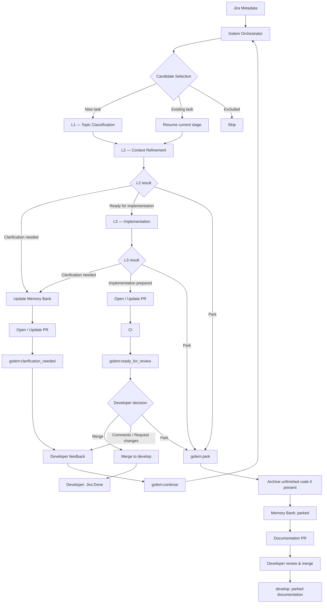
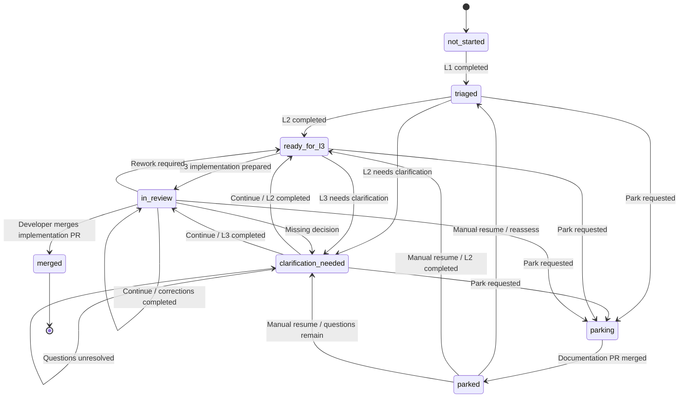

# Project Golem

**AI-assisted Jira Backlog Processing**

Automatyzacja klasyfikacji, analizy i implementacji zadań Jira z wykorzystaniem Claude Code, Memory Bank i GitHub.

**Status:** Draft — do dyskusji zespołowej

## 1. Cel projektu

### 1.1. Kontekst

Backlog Jira zawiera wiele zadań powstających przy okazji bieżących prac developerskich. Developer zauważa możliwość ulepszenia lub rozszerzenia funkcjonalności, zapisuje krótką notatkę w Jira i wraca do realizowanego zadania.

Takie issues często pozostają w backlogu przez wiele miesięcy, czasem ponad rok. Opisy bywają skrótowe, bez formalnych acceptance criteria, i zakładają znajomość istniejącej implementacji.

Przeważają pomysły rozwojowe i nowe funkcjonalności, nie naprawianie błędów.

### 1.2. Cel

**Project Golem ma doprowadzić do realizacji zadań, które w normalnym trybie pozostają niepodejmowane.**

Golem wykorzystuje AI do:

- Klasyfikowania zadań i wyszukiwania powiązanego kontekstu.
- Analizowania wymagań w istniejącym kodzie.
- Doprecyzowywania rozwiązań i identyfikowania brakujących decyzji.
- Przygotowywania implementacji i testów.
- Prowadzenia interakcji z developerami przez GitHub PR.
- Zachowywania rezultatów nieudanych lub odłożonych prac.

Największą wartość ma **rzeczywiste zdjęcie zadania z backlogu**, nawet jeśli dotyczy ono niewielkiej zmiany.

### 1.3. Środowisko

- Java, zespół developerski.
- Claude Code CLI firmy Anthropic.
- GitHub, Pull Requests, code ownership.
- Istniejący CI: build, unit tests, integration tests, E2E, deployment, static analysis.
- Jira z organizacyjnie określonym workflow.
- Istniejący mechanizm Jira Metadata, Memory Bank i indeksów tematycznych.

## 2. Koncepcja rozwiązania

### 2.1. Architektura

Golem składa się z orkiestratora oraz trzech logicznych ról AI:

- **L1 — Classifier:** klasyfikacja zadania.
- **L2 — Analyst:** analiza wymagań i rozwiązania.
- **L3 — Implementer:** implementacja i testy.

Orchestrator steruje procesem, przygotowuje kontekst, wywołuje Claude Code z promptem właściwym dla danego etapu oraz zapisuje rezultaty.

Każde wywołanie Claude Code jest osobnym, rozliczanym zadaniem. Operacje deterministyczne wykonuje skrypt.

### 2.2. Główny przepływ



L1, L2 i L3 mogą zostać wykonane w jednym przebiegu, jeżeli dostępny kontekst pozwala na kontynuację.

Parkowanie może nastąpić również po L1 lub L2, bez próby implementacji.

### 2.3. Zasady

- Golem działa na wybranych Jira issues.
- Jira jest źródłem danych tylko do odczytu.
- Praca AI jest zapisywana na branchu Git odpowiadającym zadaniu.
- GitHub PR stanowi interfejs współpracy AI z developerami.
- PR labels przekazują informacje i polecenia.
- Golem może tworzyć i aktualizować PR.
- Merge do `develop` wykonuje wyłącznie developer.
- Niedokończony kod można zarchiwizować i opublikować sam Memory Bank.
- Uruchomienie procesu Golema jest manualne.

## 3. Identyfikacja zadań i Git workflow

### 3.1. Konwencje nazw

Identyfikatorem zadania jest Jira key, np. `PROJECT-1234`.

Wspólny basename artefaktów:

`PROJECT-1234-implement-anything`

| Artefakt | Nazwa |
|---|---|
| Jira Metadata | `metadata/PROJECT-1234-implement-anything.yml` |
| Memory Bank | `memory-bank/PROJECT-1234-implement-anything.md` |
| AI branch | `ai/PROJECT-1234-implement-anything` |
| Developer feature branch | `feature/PROJECT-1234-implement-anything` |
| Documentation branch | `docs/PROJECT-1234-implement-anything` |

Commit messages rozpoczynają się od Jira key:

```text
PROJECT-1234 Classify issue
PROJECT-1234 Analyze validation rules
PROJECT-1234 Implement validation
PROJECT-1234 Add unit tests
PROJECT-1234 Update Memory Bank
```

Istniejący CI weryfikuje konwencję commit messages.

### 3.2. Git workflow

- `main` — branch release.
- Release raz w miesiącu.
- Feature branches i AI branches kierują PR do `develop`.
- Release integruje `develop` z `main`.
- Po release `develop` jest usuwany i tworzony ponownie z `main`.

Branch może należeć do pracy AI albo developera. Identyfikacja Jira issue pozostaje taka sama niezależnie od prefiksu brancha.

**Code ownership:** developer odpowiada za kod wprowadzany do projektu, w tym za kod przygotowany przez Golema. Odpowiada zarówno za poprawne, jak i błędne zmiany.

Po merge PR developer usuwa jego branch za pomocą standardowego mechanizmu GitHub.

## 4. Aktorzy i odpowiedzialności

| Aktor | Odpowiedzialność |
|---|---|
| **Jira Gateway** | Kontrolowany odczyt danych Jira |
| **Golem Orchestrator** | Selekcja issues, Git, PR, statusy, uruchamianie agentów, raportowanie |
| **L1 Classifier** | Klasyfikacja tematyczna i `ai_labels` |
| **L2 Analyst** | Analiza kodu i wymagań, propozycje rozwiązań, pytania |
| **L3 Implementer** | Implementacja, testy i poprawki |
| **Developer** | Decyzje projektowe, review, merge, Jira Done |
| **CI** | Walidacja zmian zgodnie z istniejącym pipeline |

### 4.1. Jira Gateway

Istniejący mechanizm synchronizacji jest jedyną bramą dostępu do Jira API dla Golema.

Golem korzysta z lokalnych plików metadata. Nie zapisuje danych do Jira.

W szczególności nie zmienia statusu issue na `In Progress` ani `Done`. Status `Done` ustawia developer przy zakończeniu zadania.

### 4.2. Golem Orchestrator

Orchestrator odpowiada za:

1. Odczyt lokalnych metadata i indeksów.
2. Selekcję kandydatów.
3. Sprawdzenie istniejących branchy i Memory Banków.
4. Przygotowanie kontekstu dla L1, L2 lub L3.
5. Uruchomienie Claude Code z odpowiednim promptem.
6. Odczyt wyników i aktualizację Memory Banku.
7. Operacje Git oraz GitHub PR.
8. Obsługę poleceń przekazanych przez PR labels.
9. Wyznaczanie kanonicznego stanu zadania.
10. Rejestrowanie wykonanych operacji i kosztów.

### 4.3. Role AI

Każda rola ma osobny prompt i zakres odpowiedzialności.

**L1 Classifier** pracuje na opisie issue i indeksach tematycznych.

**L2 Analyst** dostaje kod, testy, dokumentację i powiązane Memory Banki.

**L3 Implementer** otrzymuje ustalenia L2 oraz kontekst implementacyjny.

Role są wykonywane przez Claude Code CLI jako odrębne zadania logiczne i rozliczeniowe.

## 5. Jira Metadata, Memory Bank i indeksy

### 5.1. Jira Metadata

Każdemu issue odpowiada plik YAML zawierający dane pobrane przez Jira Gateway:

- Key, title, description.
- Labels.
- Epic.
- Attachments.
- Dostępne pola workflow i inne metadane.

Jeśli issue zostanie podzielone na kilka zadań, developer ręcznie usuwa stare metadata i rozdziela powiązany Memory Bank. Nowe issues przechodzą normalny proces od początku.

### 5.2. Memory Bank

Memory Bank jest używany także podczas zwykłego developmentu. Docelowo stanowi trwałe podsumowanie wykonanego zadania.

Podstawowa struktura dokumentu:

1. **Context** — problem, zakres i istotne uwarunkowania.
2. **Solution** — zastosowane lub proponowane rozwiązanie.
3. **Implementation Notes** — istotne szczegóły techniczne.
4. **Decisions** — decyzje projektowe i ich uzasadnienie.
5. **References** — istotne odnośniki.

Dla zadań opracowywanych przez Golema mogą pojawić się dodatkowe sekcje:

- **AI Findings** — fakty ustalone podczas analizy.
- **Assumptions** — założenia wymagające uwzględnienia.
- **Open Questions** — nierozstrzygnięte kwestie.
- **Parked Reason** — powód odłożenia i warunki wznowienia.

Zamknięty, zrealizowany task nie musi zawierać sekcji dotyczących otwartych pytań albo niedokończonych prac.

Nowy Memory Bank może odwoływać się do wcześniejszych issues dotyczących podobnego problemu.

### 5.3. Frontmatter

Przykład dokumentu oczekującego na doprecyzowanie:

```yaml
---
jira: PROJECT-1234
labels:
  - api
  - validation
ai_labels:
  - backward_compatibility
ai_status: needs_clarification_l2
pull_request: https://github.com/example-org/example-repo/pull/1842
---
```

`ai_status` jest zapisem ostatniego potwierdzonego wyniku pracy AI. Nie jest kanonicznym stanem całego zadania.

Kanoniczny `golem_state` jest wyznaczany przez orchestrator zgodnie z rozdziałem 7.

`pull_request` zawiera pełny URL do PR związanego z pracą nad zadaniem.

Jeżeli po parkowaniu i wznowieniu powstaną kolejne PR-y, można dodatkowo zachować historyczne referencje.

### 5.4. Labels

- `labels` — tagi pochodzące z Jira.
- `ai_labels` — tagi przypisane przez AI, przechowywane we frontmatter Memory Banku, nie w Jira.

Do indeksowania używamy sumy obu zbiorów:

`effective_labels = labels ∪ ai_labels`

L1 może samodzielnie tworzyć i modyfikować `ai_labels`, bez zatwierdzania ich przez developera.

Konsolidacja taksonomii odbywa się przy release.

### 5.5. Indeksy

Istniejące indeksy znajdują się w:

`metadata/indexes/`

Każdy indeks jest plikiem YAML zawierającym listę nazw tasków/branchy wraz z istniejącymi informacjami technicznymi.

Indeksy służą do wyszukiwania powiązanych Memory Banków i budowania kontekstu analizy.

Golem uwzględnia dokumenty z `develop` oraz aktywnych branchy. Zaparkowane Memory Banki są publikowane w `develop`.

Zachowujemy dotychczasowy model fuzzy consistency. Indeksy mogą być okresowo nieaktualne; porządkowanie następuje w procedurze release.

Indeksy i raporty mogą udostępniać wyznaczony `golem_state`, bez traktowania go jako niezależnie edytowanego pola Memory Banku.

## 6. Poziomy przetwarzania

### 6.1. L1 — Topic Classification

L1 klasyfikuje issue na podstawie Jira metadata i indeksów.

Rezultaty:

- `ai_labels`.
- Wskazanie podobnych issues.
- Identyfikacja potencjalnych duplikatów.
- Wstępna ocena możliwości dalszego opracowania.

Zakończenie L1 jest zdarzeniem `l1_completed`, niezależnie od liczby nadanych tagów.

Wynik zostaje zapisany w Memory Banku jako `ai_status: triaged`.

### 6.2. L2 — Context Refinement

L2 analizuje:

- Jira metadata i attachments.
- Istniejące Memory Banki wskazane przez indeksy.
- Aktualny kod źródłowy.
- Testy.
- Historię Git i wzorce implementacyjne.

Agent ustala cel zadania, możliwą implementację, założenia oraz pytania wymagające decyzji.

Możliwe wyniki:

| Zdarzenie | Wynik |
|---|---|
| `l2_completed` | Kontekst wystarcza do implementacji |
| `l2_clarification_required` | Brakuje decyzji lub informacji |
| `l2_failed` | Analiza zakończona niepowodzeniem technicznym |

`l2_completed` ustawia `ai_status: ready_for_l3`.

`l2_clarification_required` ustawia `ai_status: needs_clarification_l2` i powoduje przygotowanie pytań do PR.

`l2_failed` jest rejestrowane w historii wykonań, bez deklarowania zakończenia analizy.

### 6.3. L3 — Implementation Prototyping

L3 przygotowuje implementację na branchu zadania.

Agent:

1. Weryfikuje ustalenia L2.
2. Modyfikuje kod.
3. Dodaje lub aktualizuje testy.
4. Wykonuje odpowiednie testy lokalne.
5. Analizuje problemy i poprawia implementację.
6. Aktualizuje Memory Bank.
7. Przygotowuje lub aktualizuje PR.

Możliwe wyniki:

| Zdarzenie | Wynik |
|---|---|
| `l3_implementation_prepared` | Kod i testy przygotowane do review |
| `l3_clarification_required` | Implementacja wymaga dodatkowej decyzji |
| `l3_failed` | Próba zakończona niepowodzeniem technicznym |

`l3_implementation_prepared` ustawia `ai_status: implemented` i PR label `golem:ready_for_review`.

`l3_clarification_required` ustawia `ai_status: needs_clarification_l3` oraz PR label `golem:clarification_needed`.

`l3_failed` pozostaje zdarzeniem w historii wykonań; wynik próby jest zapisywany w Implementation Notes.

## 7. Canonical Task State

### 7.1. Definicja

**`golem_state` jest jedynym kanonicznym stanem zadania z perspektywy Project Golem.**

Orchestrator wyznacza go na podstawie:

- Wyników L1, L2 i L3 zapisanych w Memory Banku.
- GitHub PR labels i review.
- Rzeczywistego stanu GitHub PR.
- Zdarzeń związanych z parkowaniem.
- Lokalnych Jira metadata.

`golem_state` jest wartością wyliczaną. Może być publikowany w indeksach i raportach, ale nie jest niezależnie edytowanym statusem.

### 7.2. Stany kanoniczne

| `golem_state` | Znaczenie | Warunek |
|---|---|---|
| `not_started` | Golem nie podjął zadania | Issue dostępne, brak rozpoczętej pracy Golema |
| `triaged` | Zakończono L1 | Potwierdzony wynik klasyfikacji |
| `clarification_needed` | L2 lub L3 wymaga decyzji | Agent przygotował pytania |
| `ready_for_l3` | Analiza zakończona | L2 przygotowało wystarczający kontekst |
| `in_review` | Implementacja oczekuje na ocenę | Przygotowana implementacja i otwarty PR |
| `parking` | Trwa publikacja dokumentacji parkowania | Parkowanie zlecone lub przygotowywane |
| `parked` | Wynik odłożonej pracy został opublikowany | Merge dokumentacyjnego PR |
| `merged` | Implementacja została przyjęta do projektu | Merge implementacyjnego PR do `develop` |

`clarification_needed` jest jednym stanem kanonicznym, niezależnie od tego, czy pytania pochodzą z L2, czy L3.

`in_review` obejmuje zarówno oczekiwanie na pierwsze review, jak i iteracje po komentarzach lub Request changes.

### 7.3. Zdarzenia i źródła prawdy

| Fakt | Źródło |
|---|---|
| L1 zakończone | Wynik `l1_completed` |
| L2 zakończone | Wynik `l2_completed` |
| L3 przygotowało implementację | Wynik `l3_implementation_prepared` |
| Wymagana decyzja | Wynik L2/L3 i Memory Bank |
| Developer polecił kontynuację | PR label `golem:continue` |
| Developer polecił parkowanie | PR label `golem:park` |
| Trwa review | Otwarty PR implementacyjny |
| Implementacja została zmergowana | GitHub `merged_at` PR implementacyjnego |
| Dokumentacja parkowania została zmergowana | GitHub `merged_at` dokumentacyjnego PR |
| Jira issue zostało zamknięte | Jira metadata ze statusem Done |

Rzeczywisty merge implementacyjnego PR ma pierwszeństwo przed wcześniejszymi wynikami AI.

Merge dokumentacyjnego PR nie oznacza realizacji issue.

Status Jira `Done` jest osobną informacją biznesową i nie zastępuje `golem_state`.

### 7.4. Przejścia

| Stan początkowy | Zdarzenie | Stan wynikowy |
|---|---|---|
| `not_started` | `l1_completed` | `triaged` |
| `triaged` | `l2_completed` | `ready_for_l3` |
| `triaged` | `l2_clarification_required` | `clarification_needed` |
| `clarification_needed` | Feedback i pomyślne L2 | `ready_for_l3` |
| `clarification_needed` | Feedback i pomyślne L3 | `in_review` |
| `clarification_needed` | Pytania nadal nierozstrzygnięte | `clarification_needed` |
| `ready_for_l3` | `l3_implementation_prepared` i otwarty PR | `in_review` |
| `ready_for_l3` | `l3_clarification_required` | `clarification_needed` |
| `in_review` | Poprawki i ponowne przygotowanie implementacji | `in_review` |
| `in_review` | Ujawniono brakującą decyzję | `clarification_needed` |
| `in_review` | Konieczna ponowna analiza rozwiązania | `ready_for_l3` |
| `in_review` | Developer merguje PR implementacyjny | `merged` |
| Dowolny niezakończony | Decyzja o parkowaniu | `parking` |
| `parking` | Developer merguje dokumentacyjny PR | `parked` |
| `parked` | Manual resume | Stan wynikający z ponownej oceny L2/L3 |

Polecenie `golem:continue` samo w sobie nie ustanawia nowego stanu. Uruchamia kolejne przetwarzanie, którego wynik może zmienić `golem_state`.

Analogicznie komentarz lub Request changes w PR jest informacją zwrotną. Stan zmienia dopiero wynik kolejnego przetwarzania albo faktyczny merge.

### 7.5. Diagram



### 7.6. Wyznaczanie stanu

Orchestrator stosuje następującą kolejność rozstrzygania:

1. **`merged`** — jeśli GitHub potwierdza merge implementacyjnego PR.
2. **`parked`** — jeśli dokumentacyjny PR został zmergowany i opublikowano Memory Bank odłożonego zadania.
3. **`parking`** — jeśli trwa rozpoczęta procedura parkowania.
4. **`in_review`** — jeśli implementacja została przygotowana i istnieje otwarty PR do review.
5. **`clarification_needed`** — jeśli ostatni potwierdzony wynik L2 lub L3 wymaga decyzji.
6. **`ready_for_l3`** — jeśli ostatni potwierdzony wynik L2 dopuszcza implementację.
7. **`triaged`** — jeśli zakończono L1.
8. **`not_started`** — jeśli nie ma potwierdzonej pracy Golema.

Rozpoczęcie parkowania jest rejestrowane przez orchestrator. Dzięki temu stan `parking` pozostaje rozpoznawalny również po usunięciu polecenia `golem:park` z oryginalnego PR.

### 7.7. Memory Bank i status końcowy

Memory Bank przechowuje wynik pracy AI, np.:

```yaml
---
jira: PROJECT-1234
ai_status: implemented
---
```

Dla otwartego PR implementacyjnego kanoniczny `golem_state` wynosi `in_review`.

Po rzeczywistym merge tego PR wynosi `merged`.

W obu przypadkach `ai_status: implemented` pozostaje prawdziwym opisem pracy wykonanej przez Golema.

Dla parkowania:

```yaml
---
jira: PROJECT-1234
ai_status: parked
---
```

Przed merge dokumentacyjnego PR kanoniczny stan wynosi `parking`. Po merge — `parked`.

Pozwala to publikować finalny Memory Bank bez dodatkowego commitu aktualizującego status po merge.

### 7.8. Niepowodzenia i przerwane wykonania

Niepowodzenie pojedynczego wywołania AI nie ustanawia nowego `golem_state`.

Orchestrator zachowuje ostatni potwierdzony stan i zapisuje wynik próby w historii wykonania.

Dotyczy to również przerwania sesji, błędów technicznych i przekroczenia limitu kosztów.

## 8. GitHub PR jako interfejs sterowania

### 8.1. Labels Golema

| Label | Ustawia | Znaczenie |
|---|---|---|
| `golem:clarification_needed` | Golem | Wymagana decyzja lub informacja od developera |
| `golem:ready_for_review` | Golem | Wynik przygotowany do review |
| `golem:continue` | Developer | Przeanalizuj feedback i kontynuuj |
| `golem:park` | Developer | Przygotuj parkowanie zadania |

Labels informacyjne opisują oczekiwaną interakcję. `continue` i `park` są poleceniami.

PR labels nie są osobnymi stanami kanonicznymi.

### 8.2. Clarification

1. L2 lub L3 zapisuje pytania w Memory Banku.
2. Golem otwiera albo aktualizuje PR.
3. Ustawia `golem:clarification_needed`.
4. Developer odpowiada przez komentarz, `suggestion` lub edycję.
5. Developer ustawia `golem:continue`.
6. Orchestrator uruchamia odpowiedni etap.
7. Golem usuwa polecenie `continue` i aktualizuje label wynikowy.

### 8.3. Review

Po przygotowaniu implementacji Golem ustawia `golem:ready_for_review`.

Developer może wykonać merge, zgłosić uwagi, zmodyfikować kod albo wydać polecenie `golem:continue` lub `golem:park`.

Wynik natywnego GitHub review, w tym Request changes, oraz komentarze stanowią wejście do kolejnej iteracji.

Samo zgłoszenie uwag nie zmienia kanonicznego `golem_state: in_review`.

### 8.4. Obsługa poleceń

`golem:continue` i `golem:park` są konsumowane przez orchestrator.

Po przyjęciu polecenia jego obsługa zostaje zarejestrowana, a label usunięty. Kolejne uruchomienie nie powinno wykonywać ponownie tej samej operacji.

Labels informacyjne są aktualizowane zgodnie z wynikiem przetwarzania.

### 8.5. Code ownership

**Merge do `develop` zawsze wykonuje developer.**

AI przygotowuje zmiany, ale odpowiedzialność za wprowadzenie kodu pozostaje po stronie człowieka.

## 9. Parkowanie zadania

### 9.1. Cel

Parkowanie zachowuje wartość analizy bez wprowadzania niedokończonego kodu do `develop`.

Do `develop` trafia Memory Bank ze statusem `parked`. Jeżeli istnieje częściowa implementacja, zostaje zarchiwizowana w Git.

### 9.2. Zdarzenie parkowania

Parkowanie może wynikać z decyzji AI lub polecenia `golem:park`.

Rozpoczęcie procedury ustanawia kanoniczny stan `parking`.

Orchestrator zapisuje w Memory Banku:

- `ai_status: parked`.
- Powód odłożenia.
- Warunki wznowienia.
- Pełny URL oryginalnego PR.
- Referencję do kodu, jeżeli został zarchiwizowany.

### 9.3. Archiwizacja kodu

Jeśli branch zawiera niedokończoną implementację, Golem tworzy trwały Git tag wskazujący jej commit.

Przykład:

`golem/parked/PROJECT-1234-implement-anything`

Frontmatter:

```yaml
---
jira: PROJECT-1234
ai_status: parked

pull_request: https://github.com/example-org/example-repo/pull/1842

parked_code:
  tag: golem/parked/PROJECT-1234-implement-anything
  commit: 1234567890abcdef1234567890abcdef12345678
---
```

Tag utrzymuje referencję do commitu po usunięciu brancha roboczego.

### 9.4. Documentation PR

Golem tworzy `docs/PROJECT-1234-implement-anything` z aktualnego `develop` i przenosi na niego:

- Memory Bank.
- Metadata, jeśli wymagają publikacji.

Niedokończony kod pozostaje wyłącznie w archiwum.

Golem otwiera zwykły dokumentacyjny PR **bez labels Golema**.

Developer wykonuje standardowe review i merge, a następnie usuwa branch dokumentacyjny.

Oryginalny PR zostaje zamknięty bez merge. Branch AI można usunąć po zabezpieczeniu kodu.

Merge dokumentacyjnego PR ustanawia kanoniczny `golem_state: parked`.

### 9.5. Wznowienie

Wznowienie jest operacją manualną.

Operator wskazuje issue. Golem odczytuje Memory Bank `parked`, historyczny PR i ewentualny tag z kodem.

Tworzy nowy branch na aktualnej bazie, a następnie wykonuje ponowną ocenę przez L2 lub L3.

Dalszy `golem_state` wynika z rezultatu tej oceny. Samo wydanie polecenia resume nie oznacza zakończenia kolejnego etapu.

## 10. Selekcja Jira issues

Orchestrator wybiera kandydatów na podstawie lokalnych metadata, Memory Banków i branchy Git.

| Warunek | Zachowanie |
|---|---|
| Metadata istnieją, brak rozpoczętej pracy | Kandydat do L1 (`not_started`) |
| Jira `In Progress` | Pominięcie |
| Istnieje branch developerski dla issue | Pominięcie |
| Istnieje aktywny branch AI | Obsługa jako rozpoczęte zadanie |
| `golem_state: parking` | Oczekiwanie na zakończenie parkowania |
| `golem_state: parked` | Pominięcie |
| `golem_state: merged` | Pominięcie |
| Jira `Done` | Pominięcie |

Do wznowienia zadania `parked` wymagane jest jawne polecenie operatora.

Dostępność `golem_state` w raportach pozwala sprawdzić stan backlogu bez odczytywania historii poszczególnych wywołań AI.

## 11. Historia wykonania i koszty

Dla każdego wywołania AI Golem rejestruje:

| Pole | Znaczenie |
|---|---|
| Jira key | Identyfikator zadania |
| Etap | L1, L2 lub L3 |
| Event | Rezultat wywołania |
| Model | Wykorzystany model |
| Start / End | Czas wykonania |
| Tokens / Cost | Zużycie i koszt |
| Commit | Powiązane zmiany |
| PR URL | Powiązany Pull Request |
| Error / Reason | Przyczyna niepowodzenia |

Historia wykonania służy do rozliczalności, diagnostyki oraz pomiaru efektywności Golema.

Raport może łączyć historię prób z aktualnym kanonicznym `golem_state` danego issue.

## 12. Uruchamianie procesu

Golem jest uruchamiany manualnie.

Operator może zlecić:

- Przetworzenie wybranej grupy backlogu.
- Obsługę PR labels.
- Ponowne opracowanie issue.
- Wznowienie parked issue.
- Wygenerowanie raportu.

Developerzy komunikują się z Golemem przede wszystkim przez GitHub PR. Nie potrzebują bezpośredniego dostępu do interfejsu orkiestratora.

## 13. Release

Obowiązujący proces release:

1. Merge `develop` do `main`.
2. Usunięcie `develop`.
3. Utworzenie nowego `develop` z `main`.

Obsługa otwartych PR-ów przy odtwarzaniu `develop` jest elementem istniejącej procedury release.

Ponieważ Golem może zwiększyć liczbę otwartych PR-ów, należy wyraźnie uwzględnić je w dokumentacji tej procedury.

Przy release wykonywane jest także porządkowanie indeksów i taksonomii labels.

## 14. PoC i kryteria oceny

### 14.1. Etapy

| Faza | Zakres | Cel |
|---|---|---|
| A | Orchestrator + L1 | Selekcja issues, klasyfikacja, rejestrowanie zdarzeń i kosztów |
| B | L2 + GitHub PR | Analiza wymagań i komunikacja przez labels |
| C | L3 + CI + review | Implementacja i ocena realnych rezultatów |
| D | Parking + resume | Zachowanie analizy i kodu oraz wznowienie pracy |

### 14.2. Metryki

Raport Golema powinien pokazywać:

- Issues poddane L1.
- Issues opracowane przez L2.
- Issues, dla których uruchomiono L3.
- Issues z przygotowaną implementacją.
- Issues faktycznie zmergowane do `develop` (`merged`).
- Issues zakończone w Jira (`Done`).
- Issues zaparkowane (`parked`).
- Koszt poszczególnych etapów.
- Nakład pracy developerskiej wymagany do review i przyjęcia zmian.

**Główna metryka: liczba długo zalegających zadań faktycznie zrealizowanych i zdjętych z backlogu.**

`merged` jest liczony na podstawie zdarzenia GitHub dotyczącego PR implementacyjnego. Dokumentacyjny PR parkowania nie zwiększa tej metryki.

## 15. Podsumowanie

Project Golem wykorzystuje istniejące Jira Metadata, Memory Bank, indeksy tematyczne, GitHub oraz CI do automatycznego opracowywania zaległych zadań.

Orchestrator odpowiada za selekcję, sterowanie, GitHub i rozliczalność. Claude Code wykonuje odrębne zadania L1, L2 i L3.

**`golem_state` stanowi jeden kanoniczny model lifecycle zadania.**

- Memory Bank przechowuje potwierdzony wynik pracy AI.
- GitHub PR labels przekazują polecenia i oczekiwania.
- GitHub potwierdza rzeczywistą integrację implementacji.
- Jira przechowuje status biznesowy zadania.
- Historia Golema rejestruje próby, koszty i niepowodzenia.

Niedokończone zadania mogą zakończyć się publikacją Memory Banku ze statusem `parked`. Niedokończony kod pozostaje dostępny przez trwały Git tag.

**Miarą sukcesu projektu jest liczba rzeczywiście zrealizowanych Jira issues — nie liczba analiz, dokumentów ani wygenerowanych Pull Requestów.**
