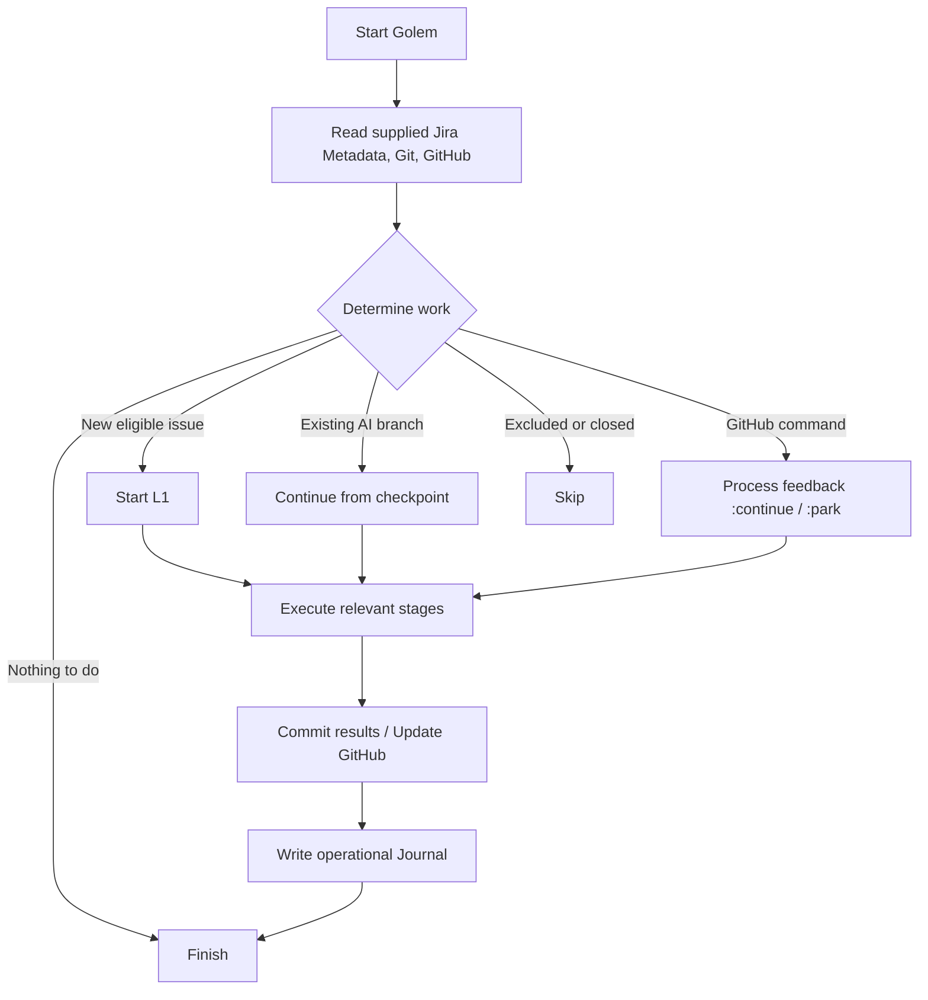
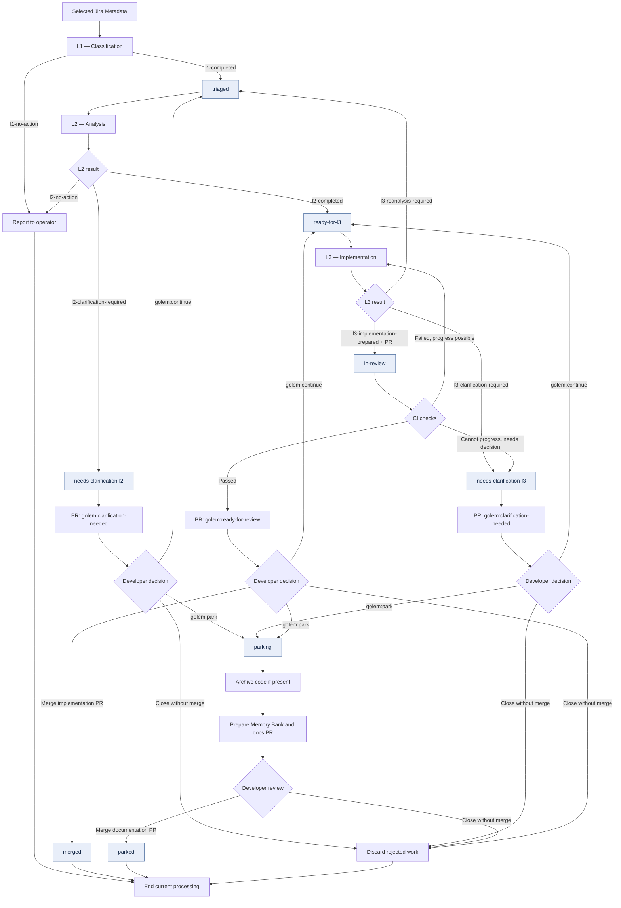

# Project Golem

**AI-assisted Jira Backlog Processing**

**Status:** Draft — do dyskusji zespołowej i realizacji inkrementalnej

## 1. Cel i założenia

Project Golem ma wspierać realizację zadań Jira, które przez wiele miesięcy pozostają w backlogu. Są to często krótkie notatki developerskie, bez formalnych acceptance criteria, zakładające znajomość istniejącego systemu.

Podstawowe założenia:

- **Minimalizować wysiłek zespołu developerskiego** poświęcany na analizę i realizację zaległych zadań.
- Samodzielnie klasyfikować, analizować i implementować zadania, o ile dostępne informacje są wystarczające.
- Pytać o konkretne decyzje i brakujący kontekst zamiast wymuszać rozwiązanie spekulacyjnym wyszukiwaniem.
- Wykorzystać istniejące Jira Metadata, Memory Bank, indeksy tematyczne, GitHub i CI.
- Zachowywać przydatną analizę również wtedy, gdy kod nie zostanie ukończony.
- **Pozostać operacyjnie stateless:** bez własnego rejestru issues, list wykluczeń, trwałej bazy stanów, backupu i procedur restore. Stan pracy jest ustalany z dostępnych Jira Metadata, Git, GitHub i Memory Banków.
- Pozostać niezależnym koncepcyjnie od konkretnego AI programming assistant. Dobór agenta i jego CLI jest szczegółem implementacyjnym.

Wartościowe rezultaty to zarówno kod przyjęty przez developera, jak i dokumentacja, która ułatwia późniejszą implementację. **Główną miarą sukcesu pozostają zrealizowane zadania przy możliwie małym nakładzie pracy developerskiej.** Liczba uruchomień AI i wygenerowanych PR-ów jest metryką pomocniczą.

### 1.1. Środowisko

- Wieloletni projekt Java, istniejący zespół i proces code review.
- Agenci programistyczni wywoływani przez CLI; orchestrator napisany w Pythonie.
- GitHub, Pull Requests, istniejący CI (build, testy, static analysis, deployment).
- Jira z istniejącym workflow i osobnym Jira Gateway.
- Jira Metadata, Memory Bank, indeksy oraz reguły projektu w `CLAUDE.md` i `.clinerules/`.

### 1.2. Zakres sterowania

Operator decyduje, które Jira issues udostępnia Golemowi, pobierając ich metadata. Golem **nie skanuje samodzielnie Jiry** ani nie importuje całego historycznego backlogu. Automatyzacja tego wyboru pozostaje poza zakresem projektu.

Nie tworzymy trwałego rejestru wcześniejszych uruchomień ani mechanizmu wykluczeń. Jeśli operator ponownie udostępni nieaktualne issue, może ono zostać ponownie przetworzone. Jest to akceptowalne.

## 2. Architektura i przepływ

### 2.1. Komponenty

| Komponent | Odpowiedzialność |
|---|---|
| **Golem Orchestrator** | Selekcja pracy, wywołania agentów, Git/GitHub, obsługa CI, Journal |
| **L1 — Classifier** | Klasyfikacja tematyczna, labels, powiązania i potencjalne duplikaty |
| **L2 — Analyst** | Zrozumienie zadania w kontekście systemu i projekt rozwiązania |
| **L3 — Implementer** | Implementacja, testy, poprawki po CI i code review |

L1, L2 i L3 są odrębnymi uruchomieniami AI z własnymi promptami i maszynowo czytelnymi wynikami. Orchestrator wykonuje operacje deterministyczne i wybiera następny krok na podstawie tych wyników.

**Jedno uruchomienie Golema może wykonać kolejno L1, L2 i L3**, a następnie opublikować gotowy implementacyjny PR bez angażowania developera pomiędzy etapami.

### 2.2. Uruchomienie Golema — diagram poglądowy

Poniższy diagram przedstawia jedynie sposób wyboru pracy przy starcie. **Nie definiuje pełnego workflow ani wszystkich przejść stanów** — te opisuje §2.3 i §7.



### 2.3. Główny workflow



Wyniki technicznie nieudanych wywołań `l1-failed`, `l2-failed` i `l3-failed` są logowane; nie ustanawiają nowego stanu zadania. Kolejne uruchomienie może ponowić odpowiedni etap.

### 2.4. Code ownership

Golem tworzy branche, commity, tagi i Pull Requests. **Merge do `develop` zawsze wykonuje developer**, który odpowiada za przyjęty kod, również wygenerowany przez AI.

Golem nie zmienia statusów Jira. Po merge implementacyjnego PR developer oznacza issue jako `Done` w zwykłym procesie.

## 3. Git workflow i release

### 3.1. Identyfikacja artefaktów

Podstawowym identyfikatorem jest Jira key. Przykładowy wspólny basename: `PROJECT-1234-implement-anything`.

| Artefakt | Ścieżka / nazwa |
|---|---|
| Jira Metadata | `metadata/PROJECT-1234-implement-anything.yml` |
| Memory Bank | `memory-bank/PROJECT-1234-implement-anything.md` |
| Developer branch | `PROJECT-1234-implement-anything` |
| AI branch | `ai/PROJECT-1234-implement-anything` |
| Documentation branch | `docs/PROJECT-1234-implement-anything` |

Commity zaczynają się od Jira key, np. `PROJECT-1234 Add validation tests`.

L1, L2 i L3 pracują na tym samym branchu `ai/*`. Wyniki pozostające w pracy są zapisywane w Git i Memory Banku, a interakcje z developerem odbywają się przez PR.

### 3.2. Release i sprzątanie branchy

Miesięczny release:

1. Merge `develop` do `main`.
2. Usunięcie `develop`.
3. Utworzenie nowego `develop` z `main`.

Istniejąca procedura uwzględnia przegląd aktywnych branchy i otwartych PR-ów. Pozostawione branche `ai/*` po odrzuconych PR-ach są sprzątane podczas tego przeglądu. Golem nie potrzebuje własnej ewidencji historycznych branchy.

## 4. Dane i kontekst agentów

### 4.1. Jira Metadata

Istniejący Jira Gateway pobiera wybrane przez operatora issues do lokalnych plików YAML. Golem czyta ten snapshot, nie odwołuje się bezpośrednio do Jira API.

Potrzebne dane obejmują Jira key, title, description, status, labels, epic, daty utworzenia i aktualizacji oraz attachments lub ich referencje.

### 4.2. Memory Bank

Memory Bank jest wspólnym artefaktem AI i developerskiego daily use. Standardowy układ:

- **Context**
- **Solution**
- **Implementation Notes**
- **Decisions**
- **References**

Na etapie analizy dopuszczalne są robocze sekcje **AI Findings**, **Assumptions**, **Proposed Solution**, **Open Questions**, **Affected Components** i **Parked Reason**.

L2 przygotowuje `Proposed Solution`. Po ukończeniu implementacji aktualne rozwiązanie jest utrwalane w standardowym **Solution**, zaś Implementation Summary, Tests i Deviations stanowią treść lub podsekcje **Implementation Notes**. Dokument przeznaczony do `develop` powinien zawierać aktualne ustalenia, nie nieaktualne pytania.

Agenci aktualizują Memory Bank bieżącego issue; nie modyfikują Memory Banków innych issues.

### 4.3. Reguły projektu: `CLAUDE.md` i `.clinerules/`

Każde uruchomienie agenta otrzymuje projektowy kontekst z `CLAUDE.md` i `.clinerules/`. `CLAUDE.md` włącza odpowiednie pliki z `.clinerules/`. Reguły opisują architekturę, bazy danych, organizację kodu, konwencje, code style i wskazówki, gdzie szukać informacji.

### 4.4. Labels i indeksy Memory Banków

- `labels` pochodzą z Jira.
- `ai-labels` przypisuje L1; są zapisywane we frontmatter Memory Banku.
- `effective-labels = labels ∪ ai-labels`.
- Indeksy YAML znajdują się w `metadata/indexes/`, obejmują `develop` i aktywne branche oraz zachowują istniejącą fuzzy consistency.

**Indeksy ograniczają zbiór Memory Banków dopuszczonych do kontekstu.** Golem nie wczytuje wszystkich Memory Banków. Po L1 orchestrator aktualizuje właściwe indeksy, aby nowo przypisane `ai-labels` były dostępne dla L2; pełne porządki pozostają elementem release.

### 4.5. Budowanie kontekstu L2

L2 otrzymuje Jira Metadata bieżącego issue, jego własny Memory Bank, powiązane Memory Banki wybrane wyłącznie przez indeksy oraz ewentualny feedback developera. Podstawą orientacji w projekcie są `CLAUDE.md` i `.clinerules/`.

**Ograniczenie dotyczy Memory Banków:** L2 nie przeszukuje całego zbioru dokumentów ani dokumentacji innych projektów. Kod źródłowy i testy **bieżącego repozytorium** może samodzielnie analizować w zakresie wynikającym z zadania i reguł projektu. Przeszukiwanie ma być celowe, a nie nieograniczone.

Jeśli zadanie wymaga dodatkowych decyzji lub kontekstu, L2 wskazuje konkretny brak i zwraca `l2-clarification-required`. Można rozszerzyć kontekst w następnym wywołaniu na podstawie uzyskanej odpowiedzi. Nie redefiniujemy samodzielnie starych issues odnoszących się do nieaktualnej architektury.

### 4.6. Kontekst ponownego L3

L3 otrzymuje aktualne Proposed Solution/Solution, bieżący kod, testy i zapisane decyzje. Przy korektach uwzględnia komentarze i suggestions PR od ostatniego commitu Golema, commity developera, wyniki testów lokalnych oraz status checks i logi CI.

L3 może samodzielnie podejmować decyzje implementacyjne. Zmiana wymagań lub projektu rozwiązania wymaga powrotu do L2 (`l3-reanalysis-required`) albo decyzji developera (`l3-clarification-required`).

## 5. Kontrakt L1/L2/L3

### 5.1. Zasady wspólne

Każdy etap zapisuje **maszynowo czytelny plik wyniku** w uzgodnionym formacie (np. YAML), w miejscu wskazanym przez orchestrator. Sterowanie opiera się na zwalidowanym polu `result`, a nie na interpretacji swobodnej prozy odpowiedzi agenta.

Niezależnie od pliku wynikowego, ustalenia merytoryczne zapisuje się w Memory Banku bieżącego issue. Brak poprawnego wyniku lub błąd wywołania oznacza `*-failed` i jest rejestrowany w Journalu.

### 5.2. Katalog wyników

| Etap | `result` | Znaczenie |
|---|---|---|
| L1 | `l1-completed` | Klasyfikacja zakończona |
| L1 | `l1-no-action` | Brak uzasadnienia dla dalszego przetwarzania |
| L1 | `l1-failed` | Niepowodzenie techniczne |
| L2 | `l2-completed` | Rozwiązanie gotowe do implementacji |
| L2 | `l2-clarification-required` | Potrzebna decyzja lub kontekst |
| L2 | `l2-no-action` | Implementacja nie jest potrzebna |
| L2 | `l2-failed` | Niepowodzenie techniczne |
| L3 | `l3-implementation-prepared` | Implementacja i testy przygotowane |
| L3 | `l3-clarification-required` | Decyzja developera potrzebna do dalszej pracy |
| L3 | `l3-reanalysis-required` | Konieczna ponowna analiza L2 |
| L3 | `l3-failed` | Niepowodzenie techniczne |

`l1-no-action` i `l2-no-action` mogą dotyczyć m.in. zadań jednoznacznie nieaktualnych lub zrealizowanych gdzie indziej. Podejrzenie duplikatu nie wystarcza do automatycznego zakończenia.

### 5.3. L1 — Classification

L1 rozpoznaje temat i zależności, przypisuje `ai-labels`, wskazuje powiązane issues i potencjalne duplikaty. Ocena `understood`, `unclear` albo `potential-duplicate` stanowi treść klasyfikacji, nie osobny `golem-state`.

Po `l1-completed` orchestrator aktualizuje indeksy i może natychmiast uruchomić L2.

### 5.4. L2 — Context Refinement

L2 analizuje aktualny system i przygotowuje rozwiązanie do implementacji, wskazując potwierdzone fakty, założenia, wymagane decyzje i referencje.

- `l2-completed` → `ready-for-l3`.
- `l2-clarification-required` → `needs-clarification-l2` i PR z pytaniami.
- `l2-no-action` → raport do operatora i koniec bieżącego przetwarzania.

Po odpowiedzi developera i `golem:continue` zadanie wraca do `triaged`, skąd L2 ponownie weryfikuje odpowiedź. Niewystarczająca odpowiedź może spowodować kolejne `l2-clarification-required`.

### 5.5. L3 — Implementation

L3 implementuje rozwiązanie, dodaje testy, wykonuje lokalną weryfikację i analizuje uwagi z CI oraz code review.

- `l3-implementation-prepared` → `in-review` po utworzeniu/aktualizacji implementacyjnego PR.
- `l3-clarification-required` → `needs-clarification-l3` i PR z pytaniami.
- `l3-reanalysis-required` → `triaged`, ponowne L2.

Po odpowiedzi developera i `golem:continue` zadanie wraca do `ready-for-l3`, a L3 ponownie ocenia odpowiedź i zmiany.

### 5.6. Przetwarzanie od początku do końca

Gdy L1 zakończy klasyfikację, L2 opracuje rozwiązanie bez pytań blokujących, a L3 przygotuje implementację, **wszystkie trzy etapy mogą wykonać się kolejno podczas jednego uruchomienia Golema**. Developer otrzymuje PR z propozycją, bez pośrednich ręcznych zatwierdzeń.

### 5.7. `no-action`

Wynik `no-action` kończy przetwarzanie bez implementacyjnego PR i review. Golem raportuje operatorowi uzasadnienie i referencje, usuwa własne nieopublikowane artefakty tego przebiegu i przechodzi do kolejnego issue.

O tym, które metadata pozostają dostępne przy następnym uruchomieniu, decyduje operator. Nie dodajemy osobnej listy historycznych wykluczeń. Jeśli te same metadata zostaną ponownie udostępnione, issue może zostać ocenione ponownie.

## 6. GitHub PR, feedback i CI

### 6.1. Labels

| Label | Ustawia | Znaczenie |
|---|---|---|
| `golem:clarification-needed` | Golem | Oczekiwanie na odpowiedź lub decyzję |
| `golem:ready-for-review` | Golem | Implementacja po weryfikacji gotowa do review |
| `golem:continue` | Developer | Uwzględnij odpowiedź i kontynuuj |
| `golem:park` | Developer | Przygotuj parkowanie |

Dwa pierwsze labels są informacyjne; dwa ostatnie są poleceniami. Orchestrator odczytuje je podczas kolejnego uruchomienia, a obsłużone polecenie usuwa po utrwaleniu odpowiedniej zmiany.

### 6.2. Clarification i review

W stanach `needs-clarification-l2` i `needs-clarification-l3` Golem publikuje pytania w Memory Banku i PR. Developer odpowiada komentarzem, suggestion lub zmianą na branchu, a następnie ustawia `golem:continue`.

| Stan | Po przyjęciu `golem:continue` | Następna operacja |
|---|---|---|
| `needs-clarification-l2` | `triaged` | L2 |
| `needs-clarification-l3` | `ready-for-l3` | L3 |
| `in-review` | `ready-for-l3` | L3 |

Komentarze i Request changes są wejściem do kolejnego L3. Nie potrzeba osobnego labela dla Request changes ani limitu liczby poleceń developera.

### 6.3. Autonomiczne poprawki CI

Po opublikowaniu implementacyjnego PR orchestrator odczytuje status checks. W przypadku błędów przekazuje logi do L3. Agent poprawia kod i testy, publikuje zmiany i korzysta z kolejnych wyników CI, dopóki potrafi robić postęp.

- **CI zielone:** Golem ustawia `golem:ready-for-review`; developer wykonuje zwykłe review.
- **CI czerwone, możliwa korekta:** L3 kontynuuje autonomicznie.
- **Brak dalszego postępu, potrzebna decyzja:** L3 przedstawia problem i zwraca `l3-clarification-required`. PR otrzymuje `golem:clarification-needed`, a zadanie przechodzi do `needs-clarification-l3`.

Czerwony CI nie jest automatycznie równoznaczny z `needs-clarification-l3`. Nie wprowadzamy osobnego stanu błędu CI. Wynik `l3-failed` oznacza błąd wykonania etapu, nie techniczną decyzję o przerwaniu nieskutecznych poprawek.

### 6.4. `golem:park` i zamknięcie PR

`golem:park` może zostać ustawione na istniejącym PR tylko przy `needs-clarification-l2`, `needs-clarification-l3` albo `in-review`. Uruchamia procedurę `parking`.

**Zamknięcie implementacyjnego PR bez merge i bez `golem:park` oznacza odrzucenie pracy.** Golem nie tworzy dokumentacyjnego PR ani nie oznacza zadania jako `parked`. Pozostały branch `ai/*` jest sprzątany w istniejącej procedurze release.

### 6.5. Polecenia GitHub

Orchestrator odczytuje aktualne PR, labels, komentarze, reviews i checks. Opcjonalną propozycją implementacyjną jest `source-event-id` w Journalu, ułatwiające odróżnienie kolejnych dodań labela od ponownego odczytu tego samego zdarzenia.

## 7. Canonical Task State

### 7.1. Źródła stanu

`golem-state` jest kanonicznym stanem ustalanym przez orchestrator na podstawie bieżącego Memory Banku, Git i GitHub. `ai-status` we frontmatter reprezentuje checkpoint pracy AI; GitHub potwierdza rzeczywisty stan PR i merge.

Memory Bank czytamy z `ai/*` dla aktywnego L1/L2/L3 i review, z `docs/*` w trakcie przygotowanego parkowania, a z `develop` po zakończeniu pracy, gdy odpowiedni dokument został tam zmergowany.

### 7.2. Stany i checkpointy

| `golem-state` | `ai-status` | Znaczenie |
|---|---|---|
| `not-started` | Brak | Nie rozpoczęto pracy Golema |
| `triaged` | `triaged` | L1 wykonane / punkt wejścia do L2 |
| `needs-clarification-l2` | `needs-clarification-l2` | Oczekiwanie na decyzję dla L2 |
| `ready-for-l3` | `ready-for-l3` | L2 zakończone / punkt wejścia do L3 |
| `needs-clarification-l3` | `needs-clarification-l3` | Oczekiwanie na decyzję dla L3 |
| `in-review` | `implemented` | Implementacja i otwarty PR, również w trakcie CI |
| `parking` | `parked` w przygotowanej dokumentacji | Dokumentacyjny PR oczekuje na decyzję |
| `parked` | `parked` | Dokumentacyjny PR zmergowany |
| `merged` | `implemented` | Implementacyjny PR zmergowany |

`parked` i `merged` są stanami terminalnymi zaakceptowanej pracy. `no-action` oraz odrzucenie PR kończą bieżące przetwarzanie bez tworzenia kolejnego stanu kanonicznego.

### 7.3. Przejścia

| Stan wejściowy | Wynik lub polecenie | Stan wyjściowy |
|---|---|---|
| `not-started` | `l1-completed` | `triaged` |
| `triaged` | `l2-completed` | `ready-for-l3` |
| `triaged` | `l2-clarification-required` | `needs-clarification-l2` |
| `needs-clarification-l2` | `golem:continue` | `triaged` |
| `ready-for-l3` | `l3-implementation-prepared` + PR | `in-review` |
| `ready-for-l3` | `l3-clarification-required` | `needs-clarification-l3` |
| `ready-for-l3` | `l3-reanalysis-required` | `triaged` |
| `needs-clarification-l3` | `golem:continue` | `ready-for-l3` |
| `in-review` | `golem:continue` | `ready-for-l3` |
| `in-review` | `l3-clarification-required` po nieudanych korektach CI | `needs-clarification-l3` |
| `in-review` | Merge implementacyjnego PR | `merged` |
| `needs-clarification-l2` | `golem:park` | `parking` |
| `needs-clarification-l3` | `golem:park` | `parking` |
| `in-review` | `golem:park` | `parking` |
| `parking` | Merge dokumentacyjnego PR | `parked` |
| `parking` | Odrzucenie dokumentacyjnego PR | Koniec, odrzucenie pracy |
| Dowolny aktywny etap L1/L2 | `*-no-action` | Koniec, raport do operatora |

`l1-failed`, `l2-failed` i `l3-failed` pozostawiają ostatni potwierdzony checkpoint. Po poprawnym przyjęciu `golem:continue` checkpoint zostaje ustawiony na `triaged` lub `ready-for-l3` przed ponownym uruchomieniem etapu.

### 7.4. Kontrakt Memory Banku

Przykład frontmatter:

```yaml
---
jira: PROJECT-1234
ai-status: implemented
ai-labels:
  - backward-compatibility
pull-request: https://github.com/example-org/example-repo/pull/1842
---
```

W czasie otwartego implementacyjnego PR stan wynosi `in-review`, nawet przy czerwonym CI. Po merge wynosi `merged`, a Memory Bank zachowuje `ai-status: implemented`.

## 8. Event Journal i metryki

### 8.1. Zakres

Journal zapisuje uruchomienia L1/L2/L3, model agenta, czas, wynik, błędy, tokens/koszt oraz powiązane Jira key, branch, commit i PR. Może też zapisywać operacje GitHub, np. obsługę labela.

Dane służą do krótkookresowej diagnostyki i oceny efektywności przez tech leada i managerów. Interesujący horyzont to zwykle kilka dni. Journal **nie wymaga backupu** i nie warunkuje dalszego działania Golema.

### 8.2. Przechowywanie

Journal może być zapisywany w lokalnym katalogu w plikach YAML/JSONL albo w bazie danych, niezależnie od repozytorium developerskiego. To wybór implementacyjny. Nie jest to rejestr issues ani źródło kanonicznego stanu.

### 8.3. Przykładowy wpis

```yaml
issue-key: PROJECT-1234
phase: L2
model: selected-agent
started-at: "2026-11-13T04:40:00Z"
finished-at: "2026-11-13T04:45:00Z"
result: l2-completed
cost:
  input-tokens: 12000
  output-tokens: 3500
  usd: 0.09
git:
  branch: ai/PROJECT-1234-implement-anything
  commit: a1b2c3d4e5f678901234567890abcdef12345678
pull-request: https://github.com/example-org/example-repo/pull/1842
```

Pola kosztowe zależą od możliwości wybranego agenta. `source-event-id` dla GitHub pozostaje opcjonalną propozycją implementacyjną.

### 8.4. Przerwane wykonanie

Jeśli L3 zakończy się błędem przed zapisaniem kodu w commicie, następne wykonanie rozpoczyna L3 od nowa. Jeżeli commit istnieje, a nie udało się opublikować PR, można dokończyć operację GitHub.

Ponowne uruchomienie rozpoznaje także rozpoczętą pracę na istniejącym branchu `ai/*`: `triaged` kieruje do L2, a `ready-for-l3` do L3. Nie wymaga to własnego rejestru uruchomień.

## 9. Parkowanie i odrzucanie pracy

### 9.1. Cel i inicjowanie

Developer inicjuje parkowanie przez `golem:park` na PR oczekującym na jego reakcję. Parkowanie zachowuje wartościową analizę bez integrowania niedokończonego kodu.

### 9.2. Archiwizacja kodu

Jeśli istnieje częściowa implementacja, Golem zapisuje commit i tworzy tag, np.:

`golem/parked/PROJECT-1234-implement-anything-a1b2c3d4`

Przykład frontmatter przygotowanej dokumentacji:

```yaml
---
jira: PROJECT-1234
ai-status: parked
pull-request: https://github.com/example-org/example-repo/pull/1842
parked-code:
  tag: golem/parked/PROJECT-1234-implement-anything-a1b2c3d4
  commit: a1b2c3d4e5f678901234567890abcdef12345678
---
```

Starsze tagi można usunąć, jeśli przestały być użyteczne. Aktualny Memory Bank zachowuje istotne ustalenia oraz potrzebne referencje.

### 9.3. Documentation PR

Golem:

1. Tworzy `docs/<basename>` z aktualnego `develop`.
2. Umieszcza tam Memory Bank i niezbędne metadata, bez niedokończonej implementacji.
3. Otwiera **zwykły dokumentacyjny PR, bez labels Golema**.
4. Po zabezpieczeniu kodu zamyka implementacyjny PR bez merge; branch AI można usunąć po publikacji taga albo posprzątać podczas release.

Developer wykonuje standardowe review. Merge dokumentacyjnego PR ustanawia `parked`; Jira pozostaje niezrealizowana.

### 9.4. Odrzucenie PR

- **Implementacyjny PR zamknięty bez merge i bez `golem:park`:** odrzucenie pracy; branch AI pozostaje do przeglądu i sprzątnięcia podczas release.
- **Dokumentacyjny PR zamknięty bez merge:** odrzucenie analizy; nie trafia ona do `develop`. Golem usuwa nieopublikowane artefakty i zbędne tagi, zachowując wcześniejszą dokumentację developerską.

Po odrzuceniu dokumentacji metadata danego issue są wycofywane z bieżącej puli wejściowej. Jeśli są śledzone w `develop`, trwała zmiana w repozytorium podlega zwykłemu procesowi Git i decyzji developera. Golem nie wykonuje automatycznego merge.

### 9.5. Ponowne podjęcie issue

`parked` jest terminalne. Jeśli operator świadomie kieruje takie issue do ponownej pracy, zaczyna się ono od L1, z aktualnymi Jira Metadata i kodem. Zachowane Memory Banki, PR-y i tagi mogą posłużyć jako referencje.

## 10. Candidate Selection i uruchamianie

### 10.1. Nowe issues

Nowe issue kwalifikuje się, gdy:

```text
metadata exists
AND jira.status == NotStarted
AND (memory-bank does not exist OR ai-status NOT IN [parked, implemented])
AND no developer branch
AND no ai/ branch
AND no docs/ branch
```

Branche są porównywane według basename issue. Istniejący Memory Bank może zawierać wcześniejsze prace developerskie i sam w sobie nie blokuje analizy. Wyjątkowe ponowne rozpatrzenie `parked` jest świadomą decyzją operatora i zaczyna się od L1.

### 10.2. Praca już rozpoczęta

Przy każdym uruchomieniu Golem rozpatruje także aktywne `ai/*` i PR-y, niezależnie od predykatu dla *nowych* issues. Kontynuuje zgodnie z checkpointem, uwzględnia polecenia GitHub oraz wyniki CI.

### 10.3. Sterowanie i raport

Golem jest uruchamiany manualnie. Operator ustala zestaw wejściowych Jira Metadata i ewentualny zakres przetwarzania. Raport może obejmować liczbę analiz, przygotowanych i zmergowanych implementacji, zaparkowanych zadań, `no-action`, błędy i koszty AI, w tym koszt na zmergowane issue, oraz nakład pracy reviewerskiej.

Nie wprowadzamy obowiązkowych limitów kosztu ani liczby `golem:continue`; można je rozważyć podczas implementacji, jeśli rzeczywista eksploatacja wykaże potrzebę.

## 11. Wymagane zmiany w istniejących danych i narzędziach

Poniższe elementy istnieją i wymagają dostosowania do kontraktu Golema, nie projektowania od zera.

### 11.1. Jira Metadata i Jira Gateway

- Dodać/zweryfikować status Jira (`NotStarted`, `In Progress`, `Done`), daty utworzenia i aktualizacji oraz attachments z referencjami.
- Zachować istniejący Gateway jako jedyny komponent korzystający z Jira API i dotychczasowe ograniczenia zapytań.
- Umożliwić operatorowi wybór issues i aktualizację lokalnej puli metadata.

### 11.2. Memory Bank

- Obsłużyć frontmatter: `jira`, `ai-status`, `ai-labels`, `pull-request`, opcjonalne `parked-code`.
- Zachować standardowe Context, Solution, Implementation Notes, Decisions i References; dopuścić sekcje robocze AI.
- Zapewnić kompatybilność dotychczasowych dokumentów i standardowego daily developmentu.

### 11.3. Indeksy

- Odczytywać `ai-labels` z frontmatter i uwzględniać `effective-labels`.
- Obejmować Memory Banki z `develop` i aktywnych branchy.
- Selekcjonować powiązane Memory Banki dla kontekstu L2 bez ładowania całego zbioru.
- Aktualizować odpowiednie indeksy po L1 i zachować istniejącą fuzzy consistency.

### 11.4. Skills developerskie

Dostosować istniejące `/memory-bank` i `/task-context` do nowych formatów metadata, frontmatter i indeksów. **Są to skille do codziennej pracy developerów; Golem ich nie wywołuje.** Wiedza z ich implementacji może później pomóc w dopracowaniu promptów agentów.

### 11.5. CI

- Sprawdzić uruchamianie standardowej weryfikacji na PR-ach z branchy `ai/*`.
- Udostępnić orchestratorowi status checks i logi nieudanych testów.
- Pozwolić na ponowną weryfikację po poprawkach L3, z zachowaniem zwykłych standardów jakości projektu.

### 11.6. GitHub i Git

- Utworzyć cztery labels wymienione w §6.1.
- Zapewnić dostęp do PR, komentarzy, reviews i status checks.
- Zapewnić możliwość tworzenia/aktualizowania/zamykania PR, zarządzania labels, pushowania commitów, tworzenia/usuwania branchy oraz tworzenia/usuwania tagów.
- Zachować zasadę merge wykonywanego wyłącznie przez developera.

### 11.7. Spójność nazewnictwa

Używać jednolitych nazw pól i wyników, w szczególności `ai-status`, `ai-labels`, `pull-request`, `l2-completed`. Nie utrzymywać równoległych wariantów tego samego kontraktu.

## 12. Realizacja inkrementalna

| Faza | Zakres |
|---|---|
| A | Jira Metadata, selekcja, L1, structured output, Journal |
| B | L2, indeksy, Memory Bank, clarification i GitHub PR |
| C | L3, testy, CI, poprawki, review i merge |
| D | Parkowanie, documentation PR, archiwizacja kodu |

Rozwój jest iteracyjny. Priorytetem jest możliwie szybkie uzyskanie działającego przebiegu od Jira Metadata do proponowanej implementacji. Wartość i jakość oceniamy podczas realnego użycia; nie przewidujemy odrębnego eksperymentu jakościowego angażującego developerów przed rozpoczęciem implementacji.

## 13. Kanoniczne prompty L1/L2/L3 — PL

Ta sekcja jest **jedynym źródłem prawdy** dla promptów. Ewentualne wersje językowe lub pliki wykonawcze powstają z niej. Orchestrator dostarcza bieżące Jira Metadata, właściwy kontekst, ścieżkę pliku wyniku i informacje o zadaniu. Każde wywołanie korzysta również z reguł `CLAUDE.md` i `.clinerules/`.

### 13.1. L1 — Topic Classification

#### Cel

Przeanalizuj opis zadania Jira i sklasyfikuj je tematycznie. Ustal powiązania, zależności i potencjalne duplikaty.

#### Zadania

1. Ustal, jakich funkcjonalności, komponentów i zagadnień technicznych dotyczy issue.
2. Przypisz odpowiednie `ai-labels`; możesz tworzyć nowe, bez preferowania istniejących.
3. Zidentyfikuj powiązane lub potencjalnie podobne issues za pomocą dostępnych indeksów.
4. Oceń, czy opis pozwala zrozumieć intencję zadania.
5. Wskaż potencjalne duplikaty i istotne zależności.
6. Sprawdź, czy dostępne fakty jednoznacznie wskazują na brak potrzeby dalszej realizacji.

#### Zasady

- Nie modyfikuj `labels` pochodzących z Jira.
- Nie zgaduj znaczenia niejasnego opisu.
- Nie zakładaj, że każde issue wymaga `ai-labels`.
- Nie modyfikuj Memory Banków innych issues ani nie przeszukuj całego ich zbioru.
- Rozróżniaj potencjalny duplikat od duplikatu potwierdzonego faktami.
- Nie implementuj rozwiązania i nie wykonuj szczegółowej analizy implementacyjnej.

#### Wynik

Uzupełnij Memory Bank bieżącego issue: krótkie podsumowanie tematu, `ai-labels`, powiązane issues i uzasadnienia, zależności oraz ocenę `understood`, `unclear` lub `potential-duplicate`.

Zapisz maszynowo czytelny wynik:

- `result`: `l1-completed`, `l1-no-action` albo `l1-failed`.
- `assessment`: `understood`, `unclear` albo `potential-duplicate`.
- `ai-labels`: lista labels.
- `related-issues`: powiązane issues z krótkim uzasadnieniem.
- `summary`: krótkie podsumowanie.
- `reason`: uzasadnienie dla `l1-no-action`.

`l1-no-action` stosuj wyłącznie przy jednoznacznych przesłankach, że dalsza realizacja nie ma sensu. W pozostałych przypadkach wybierz `l1-completed` i pozostaw analizę L2.

### 13.2. L2 — Context Refinement

#### Cel

Zrozum zadanie w kontekście istniejącego systemu i opracuj rozwiązanie nadające się do implementacji.

#### Dostępny kontekst

Otrzymujesz Jira Metadata bieżącego issue, jego Memory Bank, powiązane Memory Banki **wybrane przez indeksy** oraz ewentualny feedback developera. Kieruj się projektowymi `CLAUDE.md` i `.clinerules/`.

Nie przeszukuj całego zbioru Memory Banków ani innych projektów. Kod, testy i dokumentację bieżącego repozytorium możesz badać samodzielnie, celowo i w zakresie wynikającym z zadania. Jeżeli potrzebujesz niedostępnej wiedzy lub decyzji, wskaż konkretny brak, zamiast rozszerzać poszukiwania bez uzasadnienia.

#### Zadania

1. Przeanalizuj opis issue, aktualny Memory Bank, attachments oraz powiązane dokumenty udostępnione przez indeksy.
2. Zidentyfikuj odpowiednie moduły, klasy, interfejsy, testy i dokumentację w bieżącym projekcie.
3. Zbadaj podobne rozwiązania i wcześniejsze decyzje projektowe w dostępnym kontekście.
4. Ustal cel zadania, oczekiwane zachowanie i granice zmian.
5. Oddziel potwierdzone fakty od założeń.
6. Zaproponuj rozwiązanie spójne z istniejącą architekturą.
7. Zidentyfikuj pytania blokujące i nieblokujące.
8. Oceń, czy można bezpiecznie rozpocząć implementację oraz czy zadanie nadal jest aktualne.

#### Zasady

- Opieraj ustalenia na dostępnych dowodach z kodu, testów i dokumentacji; podawaj konkretne referencje.
- Respektuj istniejące decyzje projektowe i rozwiązuj samodzielnie kwestie jednoznaczne.
- Nie wymagaj formalnych acceptance criteria, gdy zachowanie można wiarygodnie ustalić.
- Nie implementuj rozwiązania.
- Nie redefiniuj starego issue tylko dlatego, że kod lub architektura się zmieniły.
- Preferuj konkretne pytanie do developera zamiast spekulacyjnego poszukiwania odpowiedzi.

#### Wynik

Uzupełnij Memory Bank bieżącego issue:

- **Context** — cel i zakres.
- **AI Findings** — ustalenia oparte na faktach.
- **Assumptions** — przyjęte założenia.
- **Proposed Solution** — projekt implementacji.
- **Open Questions** — pytania blokujące i nieblokujące.
- **Affected Components** — przewidywany zakres zmian.
- **References** — referencje do kodu i dokumentów.

Zapisz maszynowo czytelny wynik:

- `result`: `l2-completed`, `l2-clarification-required`, `l2-no-action` albo `l2-failed`.
- `summary`: podsumowanie analizy.
- `blocking-questions`: lista pytań blokujących.
- `requested-context`: konkretnie brakująca informacja, dokument lub wskazanie obszaru systemu.
- `reason`: uzasadnienie dla `l2-no-action`.

`l2-completed` oznacza, że Proposed Solution wystarcza do implementacji. Jeśli brakuje decyzji lub kontekstu, zwróć `l2-clarification-required`. `l2-no-action` wymaga jednoznacznego uzasadnienia, że implementacja nie jest potrzebna.

### 13.3. L3 — Implementation Prototyping

#### Cel

Zaimplementuj rozwiązanie zgodnie z przeprowadzoną analizą, aktualnym kodem i zapisanymi decyzjami projektowymi.

#### Dostępny kontekst

Otrzymujesz Proposed Solution, bieżący Memory Bank, kod i testy projektu oraz — przy kolejnych wywołaniach — feedback z PR, zmiany developera i wyniki lokalnych testów lub CI. Kieruj się `CLAUDE.md` i `.clinerules/`.

#### Zadania

1. Zweryfikuj Proposed Solution względem aktualnego kodu.
2. Zaimplementuj wymagane zmiany zgodnie z architekturą i konwencjami projektu.
3. Dodaj lub dostosuj testy.
4. Wykonaj właściwe lokalne testy i build.
5. Przeanalizuj błędy, popraw kod i testy oraz ponów weryfikację.
6. Uwzględnij otrzymane uwagi z code review i CI.
7. Wskaż istotne odstępstwa od planu i ich uzasadnienie.
8. Przygotuj podsumowanie implementacji i weryfikacji.

#### Zasady

- Respektuj dotychczasowe wymagania, architekturę, konwencje i decyzje projektowe.
- Podejmuj samodzielnie lokalne decyzje implementacyjne, które nie wymagają developera.
- Nie zmieniaj wymagań tylko po to, aby testy stały się zielone.
- Gdy dostaniesz logi błędów CI, diagnozuj i poprawiaj problem, dopóki istnieje sensowny postęp.
- Jeśli dalsza praca wymaga decyzji o zachowaniu systemu lub kontrakcie API, wyjaśnij blokadę.
- Jeśli Proposed Solution wymaga merytorycznej zmiany, skieruj zadanie do ponownej analizy L2.
- Zachowaj użyteczne rezultaty także w przypadku niepełnej implementacji.

#### Wynik

Zaktualizuj Memory Bank bieżącego issue. Po wykonanej implementacji utrwal aktualne rozwiązanie w **Solution**, a **Implementation Notes** uzupełnij o Implementation Summary, Tests i Deviations. Zachowaj aktualne Decisions i References. Nierozwiązane pytania opisz w Open Questions.

Zapisz maszynowo czytelny wynik:

- `result`: `l3-implementation-prepared`, `l3-clarification-required`, `l3-reanalysis-required` albo `l3-failed`.
- `summary`: podsumowanie wykonanej pracy.
- `tests`: testy i wyniki weryfikacji.
- `blocking-questions`: pytania wymagające decyzji.
- `reanalysis-reason`: uzasadnienie ponownego L2.
- `changed-files`: lista zmienionych plików.

`l3-implementation-prepared` oznacza kod przygotowany do PR/review. `l3-clarification-required` oznacza potrzebę decyzji developera, w tym sytuację, gdy próby poprawienia CI nie przynoszą dalszego postępu. `l3-reanalysis-required` oznacza konieczność ponownego zaprojektowania rozwiązania przez L2.

### 13.4. Granice odpowiedzialności

**L1 ustala temat i powiązania. L2 ustala rozwiązanie. L3 realizuje rozwiązanie i weryfikuje implementację.** Orchestrator zarządza etapami, walidacją wyników i operacjami Git/GitHub. Wersje językowe lub techniczne promptów można wyprowadzać z tej kanonicznej wersji PL.

## 14. Podsumowanie

Golem wykorzystuje istniejącą infrastrukturę Jira Metadata, Memory Banków, indeksów, GitHub i CI do autonomicznego opracowywania zaległych issues. W razie wystarczającego kontekstu przechodzi przez L1–L3 i publikuje PR w jednym uruchomieniu. Gdy potrzebuje decyzji, pyta developera; gdy nie warto kontynuować kodowania, może przygotować dokumentację do zaparkowania.

**Orchestrator pozostaje operacyjnie stateless, a developer zachowuje pełny code ownership.** Głównym celem pozostaje realizacja wartościowych zadań przy minimalnym wysiłku zespołu.
