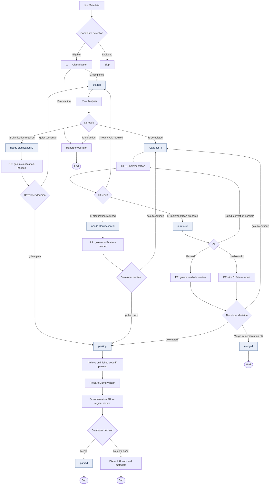

# Project Golem

**AI-assisted Jira Backlog Processing**

**Status:** Draft — do dyskusji zespołowej

## 1. Cel projektu

Project Golem ma wspierać realizację zadań Jira, które przez wiele miesięcy pozostają w backlogu.

Zadania te często powstają przy okazji bieżącego developmentu. Ich opisy bywają skrótowe, pozbawione formalnych acceptance criteria i zakładają znajomość istniejącego systemu.

Podstawowe założenia:

- **Minimalizacja wysiłku i zaangażowania zespołu developerskiego** przy przetwarzaniu zaległych zadań.
- Autonomiczna analiza i implementacja, kiedy dostępne informacje są wystarczające.
- Zadawanie developerom konkretnych pytań zamiast podejmowania nieuzasadnionych decyzji.
- Wykorzystanie istniejącej infrastruktury Jira, GitHub, CI i Memory Bank.
- Zachowywanie wartościowej wiedzy również wtedy, gdy implementacja nie zostanie ukończona.

Wartościowym efektem pracy Golema jest:

1. Kod implementujący zaległe zadanie Jira, przyjęty przez developera.
2. Analiza i dokumentacja, które ułatwią późniejszą realizację zadania.

**Główną miarą sukcesu jest liczba rzeczywiście zrealizowanych zadań przy możliwie małym nakładzie pracy developerskiej.** Liczba analiz, wywołań AI i wygenerowanych PR-ów jest metryką pomocniczą.

### 1.1. Środowisko

- Java i zespół developerski.
- Claude Code CLI firmy Anthropic.
- Python — Golem Orchestrator.
- GitHub, Pull Requests, code ownership.
- Istniejący CI: build, unit/integration/E2E tests, deployment, static analysis.
- Jira z istniejącym workflow.
- Istniejące Jira Metadata, Memory Bank i indeksy tematyczne.

## 2. Architektura i przepływ pracy

### 2.1. Komponenty

| Komponent | Odpowiedzialność |
|---|---|
| **Golem Orchestrator** | Selekcja issues, sterowanie procesem, Git, GitHub, Journal |
| **L1 — Classifier** | Klasyfikacja tematyczna i powiązane issues |
| **L2 — Analyst** | Zrozumienie zadania i przygotowanie rozwiązania |
| **L3 — Implementer** | Implementacja, testy, CI i poprawki |

Orchestrator jest skryptem napisanym w Pythonie. Wykonuje operacje deterministyczne i uruchamia odpowiednie etapy AI.

L1, L2 i L3 są **osobnymi wywołaniami Claude Code CLI**, z własnymi promptami i maszynowo czytelnymi wynikami.

Jeżeli rezultat etapu pozwala kontynuować, orchestrator automatycznie uruchamia kolejny etap.

### 2.2. Główny przepływ



Diagram pokazuje operacje, wyniki AI i polecenia developera.

Stany `parked` i `merged` kończą zaakceptowaną pracę Golema. Odrzucenie dokumentacyjnego PR oraz wynik `no-action` również kończą bieżący przebieg, bez tworzenia dodatkowych stanów kanonicznych.

### 2.3. Autonomiczne przetwarzanie

**Golem może przeprowadzić całe zadanie od L1 do L3 w jednym uruchomieniu, bez angażowania developera pomiędzy etapami.**

Typowy przebieg:

1. L1 klasyfikuje issue i identyfikuje powiązania.
2. Orchestrator aktualizuje indeksy.
3. L2 analizuje zadanie w ograniczonym kontekście i opracowuje rozwiązanie.
4. L3 implementuje rozwiązanie i testy.
5. Golem uruchamia weryfikację, publikuje PR i analizuje CI.
6. W razie błędów technicznych L3 poprawia implementację.
7. Developer otrzymuje PR z gotową propozycją do review.

Interakcja z developerem jest potrzebna, jeżeli L2/L3 wymaga decyzji albo rezultat trafia do code review.

### 2.4. Code ownership

Golem może tworzyć branche, commity i Pull Requests.

**Merge do `develop` zawsze wykonuje developer.**

Developer odpowiada za kod przyjęty do projektu, w tym za kod wygenerowany przez AI.

Golem nie wykonuje automatycznego merge ani nie zmienia statusów Jira.

## 3. Git workflow

### 3.1. Konwencje

Podstawowym identyfikatorem zadania jest Jira key, np. `PROJECT-1234`.

Wspólny basename:

`PROJECT-1234-implement-anything`

| Artefakt | Nazwa |
|---|---|
| Metadata | `metadata/PROJECT-1234-implement-anything.yml` |
| Memory Bank | `memory-bank/PROJECT-1234-implement-anything.md` |
| Developer branch | `PROJECT-1234-implement-anything` |
| AI branch | `ai/PROJECT-1234-implement-anything` |
| Documentation branch | `docs/PROJECT-1234-implement-anything` |

Commit messages zaczynają się od Jira key:

`PROJECT-1234 Add validation tests`

L1, L2 i L3 pracują na jednym branchu AI.

Po merge developer usuwa branch standardowym mechanizmem GitHub.

### 3.2. Release

Release odbywa się raz w miesiącu:

1. Merge `develop` do `main`.
2. Usunięcie `develop`.
3. Utworzenie nowego `develop` z `main`.

Istniejąca procedura release musi uwzględniać otwarte PR-y Golema na takich samych zasadach jak PR-y developerskie.

## 4. Dane wejściowe i zarządzanie kontekstem

### 4.1. Jira Metadata

Istniejący Jira Gateway pobiera dane Jira do lokalnych plików YAML.

Golem korzysta z tych plików. Jira Gateway pozostaje jedynym mechanizmem komunikacji z Jira API.

Metadata obejmują:

- Jira key, title, description.
- Status workflow.
- Labels i epic.
- Daty utworzenia oraz ostatniej aktualizacji.
- Attachments i dostępne referencje.

Golem **nie skanuje Jira**. Zna wyłącznie issues, których metadata pobrał operator.

Pobranie metadata jest decyzją o udostępnieniu zadania do przetwarzania.

### 4.2. Memory Bank

Memory Bank jest wspólnym artefaktem AI i zwykłego developmentu.

Standardowe sekcje:

- **Context**
- **Solution**
- **Implementation Notes**
- **Decisions**
- **References**

Podczas analizy mogą występować:

- **AI Findings**
- **Assumptions**
- **Proposed Solution**
- **Open Questions**
- **Affected Components**
- **Parked Reason**

Memory Bank zawiera ustalenia techniczne, decyzje i referencje do kodu, PR-ów oraz innych issues.

L1/L2/L3 aktualizują Memory Bank bieżącego zadania. Nie modyfikują dokumentów należących do innych issues.

### 4.3. Labels i indeksy

`labels` pochodzą z Jira.

`ai-labels` są przypisywane przez L1 i przechowywane we frontmatter Memory Banku.

Do wyszukiwania powiązań stosujemy:

`effective-labels = labels ∪ ai-labels`

Indeksy YAML znajdują się w `metadata/indexes/`.

Indeksy pozwalają wyszukiwać powiązane Memory Banki, również na aktywnych branchach, bez wczytywania całego zbioru dokumentacji.

Po zakończeniu L1 orchestrator aktualizuje odpowiednie indeksy na podstawie przypisanych `ai-labels`, zanim uruchomi L2.

Istniejący model fuzzy consistency pozostaje zachowany. Pełne porządkowanie indeksów odbywa się przy release.

### 4.4. Ograniczanie kontekstu L2

**Ograniczony i trafnie wybrany kontekst jest wymaganiem jakościowym Golema.**

Memory Bank zawiera już tysiące linii i stale rośnie. Wczytywanie całości powoduje nadmierne zużycie tokenów, przedwczesną kompaktyfikację kontekstu oraz pogorszenie jakości analizy.

L2 otrzymuje:

1. Jira Metadata bieżącego issue.
2. Memory Bank bieżącego issue, jeśli istnieje.
3. Powiązane Memory Banki wybrane przez indeksy na podstawie `effective-labels`.
4. Fragmenty kodu, testów i dokumentacji wskazane przez wybrane materiały.

Zakres plików jest przygotowywany przez orchestrator i istniejące narzędzia kontekstowe.

L2 nie wykonuje samodzielnego, nieograniczonego przeszukiwania repozytorium, całego Memory Banku, dysku ani innych projektów.

Jeżeli dostępny kontekst jest niewystarczający, L2 może:

- Zaproponować konkretne rozszerzenie zakresu analizy, wskazując potrzebne pliki lub komponenty.
- Zwrócić `l2-clarification-required` z pytaniem do developera.

Developer może przekazać brakujące informacje przez PR. Kolejne L2 otrzymuje kontekst rozszerzony zgodnie z przekazaną decyzją.

Rozpoznanie nieaktualnych klas, usuniętych komponentów lub zmienionej architektury nie upoważnia L2 do samodzielnego redefiniowania zadania.

W takim przypadku preferowane jest zgłoszenie problemu i uzyskanie decyzji developera.

### 4.5. Kontekst L3

L3 otrzymuje Proposed Solution przygotowane przez L2, odpowiednie fragmenty kodu oraz zapisane decyzje.

Przy kolejnych wywołaniach uwzględnia również:

- Komentarze i suggestions z PR od ostatniego commitu Golema.
- Commity developera na branchu.
- Wyniki lokalnych testów.
- Status checks oraz logi nieudanych zadań CI.

L3 może samodzielnie podejmować lokalne decyzje implementacyjne.

Jeżeli potrzebna jest zmiana wymagań, kontraktu API lub zasadniczego projektu rozwiązania, zwraca `l3-reanalysis-required` albo `l3-clarification-required`.

## 5. Kontrakt L1/L2/L3

### 5.1. Ogólne zasady

Każdy etap zwraca wynik w **ustalonym formacie maszynowo czytelnym**, np. YAML.

Orchestrator przekazuje agentowi lokalizację pliku wyniku, waliduje jego zawartość i na tej podstawie wybiera kolejny etap.

Orchestrator nie interpretuje swobodnej prozy odpowiedzi Claude Code jako polecenia sterującego.

Brak poprawnego wyniku, przerwanie procesu lub błąd wykonania oznacza niepowodzenie etapu.

Szczegółowe prompty i wymagane rezultaty znajdują się w rozdziale 13.

### 5.2. Wyniki etapów

| Etap | `result` | Znaczenie |
|---|---|---|
| L1 | `l1-completed` | Klasyfikacja zakończona |
| L1 | `l1-no-action` | Zadanie nie wymaga dalszego przetwarzania |
| L1 | `l1-failed` | Niepowodzenie |
| L2 | `l2-completed` | Rozwiązanie gotowe do implementacji |
| L2 | `l2-clarification-required` | Potrzebna decyzja developera |
| L2 | `l2-no-action` | Zadanie nie wymaga dalszego przetwarzania |
| L2 | `l2-failed` | Niepowodzenie |
| L3 | `l3-implementation-prepared` | Implementacja przygotowana do review |
| L3 | `l3-clarification-required` | Potrzebna decyzja developera |
| L3 | `l3-reanalysis-required` | Konieczna ponowna analiza L2 |
| L3 | `l3-failed` | Niepowodzenie |

### 5.3. L1 — Classification

L1 klasyfikuje temat zadania, przypisuje `ai-labels`, identyfikuje podobne issues, duplikaty i zależności.

Ocenę `understood`, `unclear` albo `potential-duplicate` zapisuje w Memory Banku jako treść analizy. Nie jest to osobny `golem-state`.

`l1-completed` pozwala uruchomić L2.

Jeżeli z dostępnych danych jednoznacznie wynika, że zadanie jest już nieaktualne lub zrealizowane gdzie indziej, L1 może zwrócić `l1-no-action` wraz z uzasadnieniem.

Samo podejrzenie duplikatu nie oznacza automatycznego odrzucenia. Może zostać zweryfikowane przez L2.

### 5.4. L2 — Context Refinement

L2 analizuje zadanie w zakresie określonym przez wybrane metadata, Memory Banki, indeksy i referencje do kodu.

Przygotowuje Proposed Solution oraz dokumentuje potwierdzone fakty, założenia i pytania.

- `l2-completed` → `ready-for-l3`.
- `l2-clarification-required` → `needs-clarification-l2`.
- `l2-no-action` → zakończenie bieżącego przetwarzania i raport do operatora.

Po odpowiedzi developera i `golem:continue` orchestrator wraca do `triaged` i ponownie uruchamia L2.

Jeżeli odpowiedź jest niewystarczająca, L2 ponownie zwraca `l2-clarification-required`.

### 5.5. L3 — Implementation

L3 implementuje Proposed Solution, dodaje testy i wykonuje lokalną weryfikację.

- `l3-implementation-prepared` → `in-review` po utworzeniu lub aktualizacji PR.
- `l3-clarification-required` → `needs-clarification-l3`.
- `l3-reanalysis-required` → `triaged`, następnie ponowne L2.

Po odpowiedzi developera i `golem:continue` orchestrator wraca do `ready-for-l3` i ponownie wykonuje L3.

Jeżeli odpowiedź jest niewystarczająca, L3 może ponownie zwrócić `l3-clarification-required`.

L3 może skierować zadanie do ponownej analizy L2, jeżeli implementacja ujawni problem z Proposed Solution.

### 5.6. Zadania nieaktualne i duplikaty

Wynik `no-action` jest możliwy, gdy dostępne dane wystarczają do stwierdzenia, że dalsza implementacja nie ma uzasadnienia.

Golem:

1. Zapisuje uzasadnienie i referencje w raporcie operacyjnym.
2. Kończy przetwarzanie bez PR i bez review developerskiego.
3. Wyłącza metadata tego issue z bieżącej puli wejściowej.

Nie zmienia Jira.

Operator może później ponownie pobrać metadata i skierować issue do analizy.

## 6. GitHub PR — komunikacja z developerem

### 6.1. Labels

| Label | Ustawia | Znaczenie |
|---|---|---|
| `golem:clarification-needed` | Golem | Oczekiwanie na informację lub decyzję |
| `golem:ready-for-review` | Golem | Implementacja przygotowana do review |
| `golem:continue` | Developer | Uwzględnij feedback i kontynuuj |
| `golem:park` | Developer | Przygotuj parkowanie |

Dwa pierwsze labels informują developera o wyniku pracy. Pozostałe są poleceniami.

### 6.2. Clarification

Golem zapisuje pytania w Memory Banku i publikuje je przez PR.

Developer odpowiada komentarzem, suggestion lub zmianą w branchu, a następnie ustawia `golem:continue`.

| Stan zadania | Efekt `golem:continue` |
|---|---|
| `needs-clarification-l2` | `triaged`, ponowne L2 |
| `needs-clarification-l3` | `ready-for-l3`, ponowne L3 |
| `in-review` | `ready-for-l3`, ponowne L3 |

Kolejny wynik L2/L3 ustala dalszy stan.

### 6.3. Code review i CI

Po przygotowaniu implementacji Golem publikuje PR i uruchamia standardowy CI.

Golem odczytuje status checks i wyniki testów. W razie błędów przekazuje logi do L3, które analizuje je, poprawia kod i testy oraz ponownie uruchamia weryfikację.

Ten cykl odbywa się autonomicznie, dopóki L3 robi postęp.

Jeżeli nie potrafi usunąć błędów, przedstawia developerowi PR z aktualnym kodem i raportem niepowodzenia.

Czerwony CI sam w sobie nie oznacza `needs-clarification-l3`. Taki stan jest używany wtedy, gdy potrzebna jest decyzja developera.

Po pomyślnym zakończeniu CI Golem ustawia `golem:ready-for-review`.

Developer może:

- Wykonać merge.
- Zgłosić komentarze lub Request changes.
- Samodzielnie poprawić kod.
- Ustawić `golem:continue`.
- Ustawić `golem:park`.

Nie stosujemy arbitralnego limitu liczby poleceń `golem:continue`.

### 6.4. Parkowanie

`golem:park` może zostać ustawione na PR w stanie:

- `needs-clarification-l2`
- `needs-clarification-l3`
- `in-review`

Przyjęcie polecenia rozpoczyna `parking`.

### 6.5. Obsługa poleceń

Orchestrator odczytuje labels przy kolejnym uruchomieniu Golema.

Po przyjęciu polecenia wykonuje przypisaną operację i usuwa obsłużony label.

**Propozycja implementacyjna:** Journal może przechowywać `source-event-id` identyfikujące dodanie labela w GitHub, aby odróżnić nowe polecenia od ponownego odczytania wcześniejszego zdarzenia.

## 7. Canonical Task State

### 7.1. Definicja

`golem-state` jest kanonicznym stanem zadania, ustalanym przez orchestrator na podstawie Memory Banku i rzeczywistych danych GitHub.

`ai-status` we frontmatter przechowuje checkpoint pracy AI. GitHub potwierdza stan PR i faktyczny merge.

### 7.2. Stany

| `golem-state` | Znaczenie |
|---|---|
| `not-started` | Brak rozpoczętej pracy Golema |
| `triaged` | L1 zakończone; można wykonać L2 |
| `needs-clarification-l2` | L2 oczekuje na decyzję developera |
| `ready-for-l3` | L2 zakończone; można wykonać L3 |
| `needs-clarification-l3` | L3 oczekuje na decyzję developera |
| `in-review` | Implementacja i PR przygotowane |
| `parking` | Trwa przygotowanie i review dokumentacji parkowania |
| `parked` | Dokumentacyjny PR zmergowany |
| `merged` | Implementacyjny PR zmergowany do `develop` |

`parked` i `merged` są stanami terminalnymi.

### 7.3. Przejścia

| Stan początkowy | Zdarzenie lub polecenie | Stan wynikowy |
|---|---|---|
| `not-started` | `l1-completed` | `triaged` |
| `triaged` | `l2-completed` | `ready-for-l3` |
| `triaged` | `l2-clarification-required` | `needs-clarification-l2` |
| `needs-clarification-l2` | `golem:continue` | `triaged` |
| `ready-for-l3` | `l3-implementation-prepared` i PR | `in-review` |
| `ready-for-l3` | `l3-clarification-required` | `needs-clarification-l3` |
| `ready-for-l3` | `l3-reanalysis-required` | `triaged` |
| `needs-clarification-l3` | `golem:continue` | `ready-for-l3` |
| `in-review` | `golem:continue` | `ready-for-l3` |
| `in-review` | Merge implementacyjnego PR | `merged` |
| `needs-clarification-l2` | `golem:park` | `parking` |
| `needs-clarification-l3` | `golem:park` | `parking` |
| `in-review` | `golem:park` | `parking` |
| `parking` | Merge dokumentacyjnego PR | `parked` |
| `parking` | Odrzucenie dokumentacyjnego PR | Zakończenie pracy i usunięcie artefaktów |

Wyniki `l1-no-action` i `l2-no-action` kończą bieżący przebieg bez tworzenia PR i bez przypisywania dodatkowego `golem-state`.

Niepowodzenia techniczne pozostawiają ostatni potwierdzony stan bez zmian.

### 7.4. `ai-status`

| `ai-status` | Znaczenie |
|---|---|
| `triaged` | L1 zakończone albo powrót do L2 |
| `needs-clarification-l2` | L2 oczekuje na decyzję |
| `ready-for-l3` | L2 zakończone albo powrót do L3 |
| `needs-clarification-l3` | L3 oczekuje na decyzję |
| `implemented` | L3 przygotowało implementację |
| `parked` | Przygotowano dokumentację parkowania |

Orchestrator aktualizuje `ai-status` przy przyjęciu `golem:continue`, wskazując ponownie wykonywany etap.

Przykład:

```yaml
---
jira: PROJECT-1234
ai-status: implemented
pull-request: https://github.com/example-org/example-repo/pull/1842
---
```

Dla otwartego PR kanoniczny stan wynosi `in-review`.

Po merge implementacyjnego PR wynosi `merged`, podczas gdy Memory Bank zachowuje `ai-status: implemented`.

### 7.5. Źródło Memory Banku

Dla aktywnej pracy Golem odczytuje Memory Bank z brancha AI.

Jeżeli branch AI nie istnieje, korzysta z dokumentacji dostępnej w `develop`.

Ostateczny status merge jest ustalany na podstawie GitHub.

## 8. Event Journal

### 8.1. Przeznaczenie

Golem prowadzi Journal rejestrujący:

- Wywołania L1, L2 i L3.
- Modele, czas wykonania, tokeny i koszty.
- Wyniki oraz błędy.
- Powiązane Jira keys, commity i PR-y.
- Operacje Git i GitHub, w tym obsługę poleceń.

### 8.2. Przechowywanie

Journal jest przechowywany niezależnie od repozytorium projektu, w miejscu dostępnym dla Golem Orchestratora.

Może to być katalog z plikami YAML/JSONL albo baza danych.

Wybór należy do implementacji.

### 8.3. Przykładowy rekord

```yaml
issue-key: PROJECT-1234
phase: L2
model: claude-sonnet
started-at: "2026-11-12T00:40:00Z"
finished-at: "2026-11-12T00:45:00Z"
result: l2-completed

cost:
  input-tokens: 12000
  output-tokens: 3500
  usd: 0.09

git:
  branch: ai/PROJECT-1234-implement-anything
  commit: a1b2c3d4e5f678901234567890abcdef12345678

pull-request: https://github.com/example-org/example-repo/pull/1842
```

Dokładna reprezentacja kosztów zależy od danych udostępnianych przez Claude Code.

### 8.4. Niepowodzenia

Jeśli L3 zakończy się błędem przed zapisaniem implementacji w commicie, kolejne wykonanie rozpoczyna L3 od nowa.

Jeśli commit istnieje, ale publikacja PR nie została zakończona, orchestrator może dokończyć operację GitHub.

Wszystkie wykonane wywołania AI są uwzględniane w raportowaniu kosztów.

## 9. Parkowanie

### 9.1. Cel

Parkowanie zachowuje wartościowe wyniki analizy bez integrowania niedokończonego kodu produkcyjnego.

Developer inicjuje parkowanie przez `golem:park` na istniejącym PR.

### 9.2. Archiwizacja kodu

Jeżeli istnieje niedokończona implementacja, Golem zapisuje commit SHA i tworzy tag:

`golem/parked/PROJECT-1234-implement-anything-a1b2c3d4`

Przykład frontmatter:

```yaml
---
jira: PROJECT-1234
ai-status: parked
pull-request: https://github.com/example-org/example-repo/pull/1842

parked-code:
  tag: golem/parked/PROJECT-1234-implement-anything-a1b2c3d4
  commit: a1b2c3d4e5f678901234567890abcdef12345678
---
```

Starsze tagi mogą zostać usunięte, jeśli wcześniejszy kod nie przedstawia już wartości.

### 9.3. Documentation PR

Golem:

1. Tworzy `docs/PROJECT-1234-implement-anything` z aktualnego `develop`.
2. Przenosi Memory Bank i niezbędne metadata.
3. Otwiera zwykły dokumentacyjny PR.
4. Po zabezpieczeniu kodu zamyka oryginalny PR implementacyjny bez merge i usuwa branch AI.

**Dokumentacyjny PR nie otrzymuje labels Golema.**

Developer wykonuje standardowe review i merge.

Potwierdzony merge dokumentacyjnego PR ustanawia `parked`.

### 9.4. Odrzucenie dokumentacji

Zamknięcie dokumentacyjnego PR bez merge oznacza odrzucenie tej pracy.

Golem usuwa jej nieopublikowane artefakty i zbędne tagi, zachowując wcześniejszą dokumentację projektu.

Usuwa także plik metadata tego issue z puli wejściowej, aby nie zostało automatycznie wybrane w następnym uruchomieniu.

Odrzucona praca nie trafia do `develop`.

### 9.5. Ponowne podjęcie issue

Zaparkowane issue jest wyłączone z automatycznej selekcji.

Jeżeli operator zdecyduje o jego ponownym opracowaniu, Golem rozpoczyna standardowe przetwarzanie od L1.

Analiza wykorzystuje aktualne Jira Metadata i kod. Istniejący Memory Bank, historyczne PR-y i tagi są materiałami referencyjnymi.

## 10. Candidate Selection

Golem korzysta z lokalnych plików Jira Metadata udostępnionych przez operatora.

Warunek kwalifikacji nowego issue:

```text
metadata exists
AND jira.status == NotStarted
AND (memory-bank does not exist OR ai-status != parked)
AND no developer branch
AND no ai/ branch
AND no docs/ branch
```

Branche są sprawdzane według wspólnego basename:

- `PROJECT-1234-implement-anything`
- `ai/PROJECT-1234-implement-anything`
- `docs/PROJECT-1234-implement-anything`

Istniejący Memory Bank może zawierać wcześniejsze ustalenia developera. Jego obecność nie wyklucza przetwarzania, o ile nie jest oznaczony jako `parked`.

Golem nie pobiera samodzielnie nowych issues z Jira. To operator decyduje, jakie metadata udostępnia.

Podczas jednego uruchomienia orchestrator może rozpocząć nowe kwalifikujące się issues oraz obsłużyć `golem:continue` i `golem:park` na wcześniej utworzonych PR-ach.

## 11. Wymagane zmiany w istniejących danych i narzędziach

Istniejąca infrastruktura Jira Metadata, Memory Bank i indeksowania stanowi podstawę Golema. Przed integracją trzeba ją dostosować do nowego kontraktu.

### 11.1. Jira Metadata

Rozszerzyć istniejący format i skrypt Jira Gateway o dane wymagane przez Golema:

- Status Jira, w szczególności rozpoznawanie `NotStarted`, `In Progress` i `Done`.
- Daty utworzenia oraz ostatniej aktualizacji.
- Attachments i ich referencje.
- Pozostałe informacje potrzebne do identyfikacji issue i jego kontekstu.

Zachować istniejący sposób pobierania danych oraz ograniczenia Jira API.

### 11.2. Memory Bank

Dostosować frontmatter Memory Banku do Golema.

Wymagane pola:

| Pole | Przeznaczenie |
|---|---|
| `jira` | Identyfikator issue |
| `ai-status` | Checkpoint pracy AI |
| `ai-labels` | Labels przypisane przez L1 |
| `pull-request` | Powiązany PR |
| `parked-code` | Opcjonalny tag i SHA niedokończonej implementacji |

Pola opcjonalne są pomijane, gdy nie mają zastosowania.

Zachować dotychczasową strukturę Memory Banku, rozszerzając ją o sekcje potrzebne podczas analizy i implementacji.

Nie tworzyć osobnego formatu dokumentacji przeznaczonego wyłącznie dla AI.

### 11.3. Indeksy

Dostosować istniejące skrypty indeksujące:

- Odczytywać `ai-labels` z frontmatter Memory Banku.
- Uwzględniać `effective-labels = labels ∪ ai-labels`.
- Obsługiwać Memory Banki z `develop` oraz aktywnych branchy.
- Umożliwiać wybór ograniczonego zbioru powiązanych dokumentów dla L2.
- Aktualizować odpowiednie indeksy po zakończeniu L1.
- Zachować dotychczasowy model fuzzy consistency.

L2 korzysta z wyników indeksowania jako podstawowego mechanizmu selekcji kontekstu.

### 11.4. Skills developerskie

Dostosować istniejące skills w repozytorium developerskim:

- `/memory-bank`
- `/task-context`

Wymagany zakres:

- Obsługa nowego frontmatter.
- Zgodność z sekcjami Memory Banku używanymi przez Golema.
- Selektywne wczytywanie dokumentów na podstawie indeksów.
- Przygotowanie ograniczonego kontekstu dla L2.
- Zachowanie możliwości używania tych skills w zwykłym developmentcie, niezależnie od Golema.

### 11.5. CI

Sprawdzić i w razie potrzeby dostosować istniejące workflow CI:

- Uruchamianie standardowej weryfikacji dla branchy `ai/*` i ich PR.
- Dostępność status checks oraz logów dla orchestratora.
- Możliwość automatycznej ponownej weryfikacji po poprawkach L3.

Weryfikacja AI powinna korzystać z tych samych standardów jakości co zwykły development.

### 11.6. GitHub

Przygotować cztery labels Golema:

- `golem:clarification-needed`
- `golem:ready-for-review`
- `golem:continue`
- `golem:park`

Orchestrator musi mieć uprawnienia do odczytu PR, komentarzy, reviews i status checks oraz do tworzenia branchy, commitów, PR i zarządzania labels.

### 11.7. Konwencje nazw i kompatybilność

Ujednolicić istniejące skrypty i dokumentację z nazwami stosowanymi przez Golema, np. `ai-status`, `ai-labels`, `pull-request` i `l2-completed`.

Nie utrzymywać równolegle dwóch nazw oznaczających to samo pole lub rezultat.

Zmiany powinny zachować możliwość korzystania z dotychczasowych Memory Banków przez developerów.

## 12. Uruchamianie, raportowanie i rozwój

### 12.1. Uruchamianie

Golem jest uruchamiany manualnie.

Operator może wskazać zakres issues, przetworzyć aktualne polecenia na PR-ach albo wygenerować raport.

### 12.2. Raportowanie

Raport obejmuje:

- Liczbę issues poddanych L1, L2 i L3.
- Liczbę przygotowanych implementacji.
- Liczbę zmergowanych implementacji.
- Liczbę zaparkowanych issues.
- Liczbę issues zakończonych jako `no-action`.
- Koszty AI według etapów i modeli.
- Koszt AI przypadający na zmergowane issue.
- Błędy wykonania.
- Nakład pracy developerskiej wymagany do clarification i review.

Limity kosztów i liczby issues na uruchomienie mogą być konfigurowalne, ale nie są warunkiem pierwszej implementacji.

### 12.3. Inkrementalny rozwój

| Faza | Zakres |
|---|---|
| A | Jira Metadata, kontekst, kontrakt wyników, L1, Journal |
| B | L2, Memory Bank, indeksy, GitHub PR i clarification |
| C | L3, testy, CI, poprawki, review i merge |
| D | Parkowanie, dokumentacyjny PR i archiwizacja kodu |

Rozwój jest iteracyjny. Poszczególne elementy są uruchamiane i oceniane podczas rzeczywistego użycia.

Priorytetem jest możliwie szybkie uzyskanie działającego przepływu od Jira Metadata do propozycji implementacji, a następnie jego doskonalenie na podstawie rzeczywistych wyników i kosztów.

## 13. Prompty L1/L2/L3

Poniższe prompty są kanonicznymi instrukcjami dla trzech etapów Claude Code CLI.

Orchestrator dostarcza każdemu etapowi odpowiedni kontekst, lokalizację pliku wyniku oraz informacje o bieżącym zadaniu.

Nazwy pól i wartości `result` muszą być zgodne z kontraktem z rozdziału 5.

### 13.1. L1 — Topic Classification

#### Cel

Przeanalizuj opis zadania Jira i sklasyfikuj je tematycznie. Zidentyfikuj powiązane issues, potencjalne duplikaty i zależności.

#### Zadania

1. Ustal, jakich funkcjonalności, komponentów i zagadnień technicznych dotyczy issue.
2. Przypisz odpowiednie `ai-labels`. Możesz tworzyć nowe labels, bez preferowania istniejących.
3. Zidentyfikuj podobne lub potencjalnie powiązane issues na podstawie dostępnych indeksów.
4. Oceń, czy opis pozwala zrozumieć intencję zadania.
5. Wskaż potencjalne duplikaty oraz istotne zależności.
6. Oceń, czy dostępne dane jednoznacznie wskazują, że zadanie jest nieaktualne albo zostało już zrealizowane.

#### Zasady

- Nie modyfikuj `labels` pochodzących z Jira.
- Nie zgaduj znaczenia niejasnych opisów.
- Nie zakładaj, że każde issue musi otrzymać `ai-labels`.
- Nie modyfikuj Memory Banków innych issues.
- Nie przeszukuj samodzielnie całego Memory Banku ani innych projektów.
- Potencjalny duplikat nie jest automatycznie potwierdzonym duplikatem.
- Nie implementuj rozwiązania i nie podejmuj szczegółowej analizy implementacyjnej.

#### Wynik

Zaktualizuj Memory Bank bieżącego issue, zapisując:

- `ai-labels`.
- Krótkie podsumowanie rozpoznanego tematu.
- Ocenę `understood`, `unclear` albo `potential-duplicate`.
- Powiązane issues wraz z krótkim uzasadnieniem.
- Istotne zależności.

W pliku wyniku zapisz:

- **`result`** — `l1-completed`, `l1-no-action` albo `l1-failed`.
- **`assessment`** — `understood`, `unclear` albo `potential-duplicate`.
- **`ai-labels`** — lista przypisanych labels.
- **`related-issues`** — lista powiązanych issues.
- **`summary`** — krótkie podsumowanie.
- **`reason`** — uzasadnienie, jeżeli wynik to `l1-no-action`.

Użyj `l1-no-action` tylko wtedy, gdy dostępne dane wystarczają do jednoznacznego stwierdzenia, że dalsza realizacja zadania nie ma uzasadnienia.

W przeciwnym przypadku zakończ klasyfikację jako `l1-completed` i pozostaw dalszą ocenę L2.

### 13.2. L2 — Context Refinement

#### Cel

Zrozum zadanie w kontekście istniejącego systemu i opracuj rozwiązanie nadające się do implementacji.

#### Dostępny kontekst

Orchestrator dostarcza:

- Jira Metadata bieżącego issue.
- Memory Bank bieżącego issue.
- Dokumenty wybrane przez indeksy na podstawie `effective-labels`.
- Wskazane fragmenty kodu, testów i dokumentacji.
- Feedback developera, jeżeli L2 jest wykonywane ponownie.

**Pracuj wyłącznie w dostarczonym zakresie kontekstu.**

Nie wykonuj samodzielnego, szerokiego wyszukiwania w repozytorium, całym Memory Banku, na dysku ani w innych projektach.

Jeżeli potrzebujesz dodatkowych materiałów, wskaż konkretnie, czego brakuje i dlaczego.

#### Zadania

1. Przeanalizuj opis issue, Memory Bank i attachments dostępne w przekazanym kontekście.
2. Zidentyfikuj powiązane moduły, klasy, interfejsy i testy.
3. Sprawdź podobne implementacje i wcześniejsze decyzje projektowe w dostępnych materiałach.
4. Ustal rzeczywisty cel zadania i oczekiwane zachowanie.
5. Oddziel potwierdzone fakty od założeń.
6. Zaproponuj rozwiązanie zgodne z istniejącą architekturą.
7. Zidentyfikuj pytania wymagające decyzji developera.
8. Oceń, czy kontekst wystarcza do rozpoczęcia implementacji.
9. Oceń, czy aktualny system nadal wymaga zmiany opisanej w issue.

#### Zasady

- Opieraj ustalenia na dostarczonym kodzie, testach i dokumentacji.
- Podawaj konkretne referencje do istotnych elementów kodu.
- Respektuj wcześniej zapisane decyzje projektowe.
- Rozstrzygaj samodzielnie kwestie wynikające jednoznacznie z dostępnych materiałów.
- Dziel pytania na blokujące i nieblokujące.
- Nie wymagaj formalnych acceptance criteria, jeżeli oczekiwane zachowanie można wiarygodnie ustalić.
- Nie implementuj rozwiązania na tym etapie.
- Nie redefiniuj samodzielnie zadania, jeśli opis odnosi się do nieaktualnego kodu lub architektury.
- Preferuj konkretne pytanie do developera zamiast spekulacyjnego poszukiwania rozwiązania.

#### Wynik

Zaktualizuj Memory Bank bieżącego issue:

- **Context** — cel i zakres zadania.
- **AI Findings** — potwierdzone ustalenia.
- **Assumptions** — przyjęte założenia.
- **Proposed Solution** — projekt implementacji.
- **Open Questions** — pytania blokujące i nieblokujące.
- **Affected Components** — przewidywany zakres zmian.
- **References** — istotne referencje.

W pliku wyniku zapisz:

- **`result`** — `l2-completed`, `l2-clarification-required`, `l2-no-action` albo `l2-failed`.
- **`summary`** — krótkie podsumowanie analizy.
- **`blocking-questions`** — lista pytań blokujących.
- **`requested-context`** — konkretne dodatkowe materiały, jeśli są potrzebne.
- **`reason`** — uzasadnienie dla `l2-no-action`.

Zwróć `l2-completed` wyłącznie wtedy, gdy istnieje rozwiązanie wystarczająco określone do implementacji.

Jeżeli do podjęcia decyzji brakuje informacji albo potrzebne jest rozszerzenie kontekstu, zwróć `l2-clarification-required`.

Jeżeli z dostępnych danych jednoznacznie wynika, że zadanie jest nieaktualne lub zduplikowane i nie wymaga implementacji, zwróć `l2-no-action` z uzasadnieniem.

### 13.3. L3 — Implementation Prototyping

#### Cel

Zaimplementuj rozwiązanie na podstawie ukończonej analizy i zapisanych decyzji projektowych.

#### Dostępny kontekst

Orchestrator dostarcza:

- Proposed Solution oraz odpowiedni Memory Bank.
- Kod, testy i dokumentację istotne dla implementacji.
- Wcześniejszy feedback z code review.
- Commity developera na branchu, jeżeli występują.
- Wyniki lokalnych testów i GitHub CI.

#### Zadania

1. Zweryfikuj Proposed Solution względem aktualnego kodu.
2. Zaimplementuj wymagane zmiany.
3. Dodaj lub dostosuj testy.
4. Uruchom odpowiednie testy lokalne i build.
5. Przeanalizuj wykryte błędy i popraw implementację.
6. Uwzględnij wcześniejszy feedback z code review i CI, jeśli istnieje.
7. Zidentyfikuj istotne odstępstwa od Proposed Solution.
8. Przygotuj podsumowanie implementacji i wyników testów.
9. Jeżeli orchestrator przekazał logi nieudanego CI, przeanalizuj je i przygotuj poprawki.

#### Zasady

- Przestrzegaj istniejących konwencji i architektury projektu.
- Respektuj zapisane decyzje projektowe.
- Podejmuj samodzielnie lokalne decyzje implementacyjne, jeśli nie wymagają decyzji developera.
- Jeżeli niejednoznaczność wpływa na zachowanie systemu lub kontrakt API, zgłoś pytanie i wyjaśnij, co blokuje dalszą pracę.
- Nie zmieniaj wymagań tylko po to, aby uzyskać pozytywne wyniki testów.
- Analizuj błędy testów i CI oraz poprawiaj kod, dopóki osiągasz postęp.
- Nie wprowadzaj nieuzasadnionych zmian poza uzgodnionym zakresem.
- Jeśli Proposed Solution jest nieaktualne lub niepoprawne, skieruj zadanie do ponownej analizy L2.
- Zachowaj użyteczne wyniki również wtedy, gdy implementacja pozostaje niekompletna.

#### Wynik

Zaktualizuj Memory Bank bieżącego issue:

- **Implementation Summary** — wykonane zmiany.
- **Tests** — dodane testy i wyniki uruchomień.
- **Deviations** — odstępstwa od projektu wraz z uzasadnieniem.
- **Open Questions** — zagadnienia nierozstrzygnięte.
- **Implementation Notes** — informacje przydatne do review i dalszej pracy.

W pliku wyniku zapisz:

- **`result`** — `l3-implementation-prepared`, `l3-clarification-required`, `l3-reanalysis-required` albo `l3-failed`.
- **`summary`** — krótkie podsumowanie wykonanej pracy.
- **`tests`** — informacje o wykonanej weryfikacji.
- **`blocking-questions`** — pytania wymagające decyzji developera.
- **`reanalysis-reason`** — uzasadnienie konieczności ponownego L2.
- **`changed-files`** — lista zmienionych plików.

Zwróć `l3-implementation-prepared`, gdy kod jest przygotowany do review.

Zwróć `l3-clarification-required`, jeśli dalsza praca wymaga decyzji developera.

Zwróć `l3-reanalysis-required`, jeśli trzeba ponownie ocenić lub zmienić Proposed Solution. Wyjaśnij, co wykryto i jakie ustalenia L2 wymagają weryfikacji.

### 13.4. Granice odpowiedzialności

- **L1 ustala temat i powiązania.**
- **L2 ustala rozwiązanie.**
- **L3 realizuje rozwiązanie i weryfikuje implementację.**

Każdy etap może wykryć problem wymagający ponownej analizy, ale nie powinien bez potrzeby powtarzać pracy poprzednika.

Orchestrator odpowiada za wybór kolejnego etapu, Git, GitHub, Journal i walidację wyników.

## 14. Podsumowanie

Project Golem wykorzystuje istniejącą infrastrukturę Jira Metadata, Memory Bank, indeksów tematycznych, GitHub i CI.

Trzy etapy AI są sterowane przez skryptowy orchestrator. Gdy kontekst pozwala, cały proces od klasyfikacji do przygotowania PR może zostać wykonany w jednym uruchomieniu.

- **`golem-state`** opisuje bieżący stan zadania.
- **`ai-status`** przechowuje checkpoint pracy w Memory Banku.
- **GitHub labels** służą do komunikacji i sterowania przez developera.
- **GitHub** potwierdza rzeczywisty merge.
- **Event Journal** rejestruje wykonanie i koszty.
- **Developer** zachowuje pełny code ownership.

Praca może zakończyć się przyjęciem implementacji (`merged`), opublikowaniem dokumentacji niedokończonego zadania (`parked`) albo stwierdzeniem, że dalsza implementacja nie jest potrzebna.

**Priorytetem projektu jest realizowanie wartościowych zadań z backlogu przy minimalnym zaangażowaniu zespołu developerskiego.**
